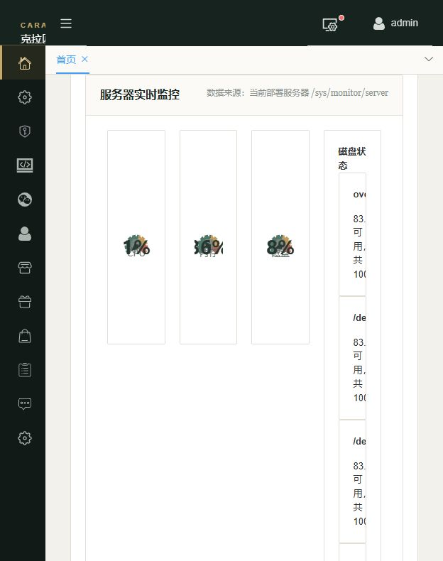
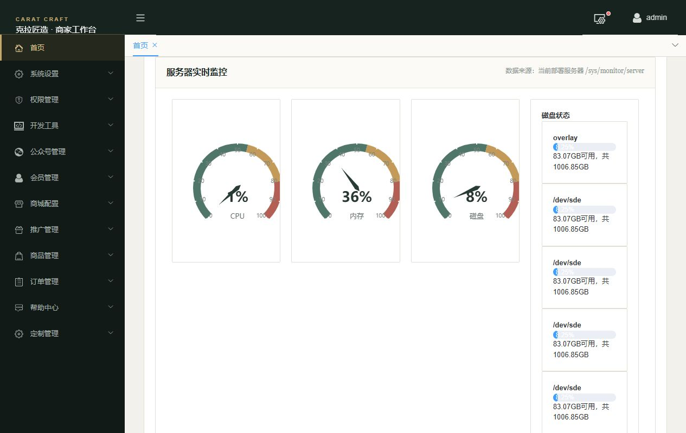
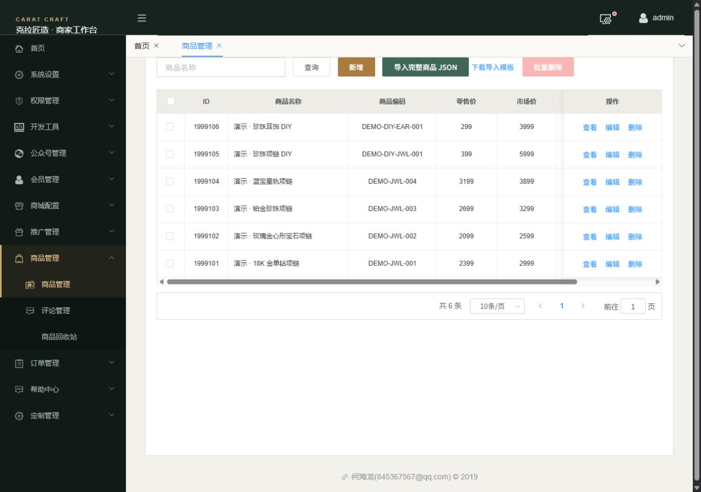
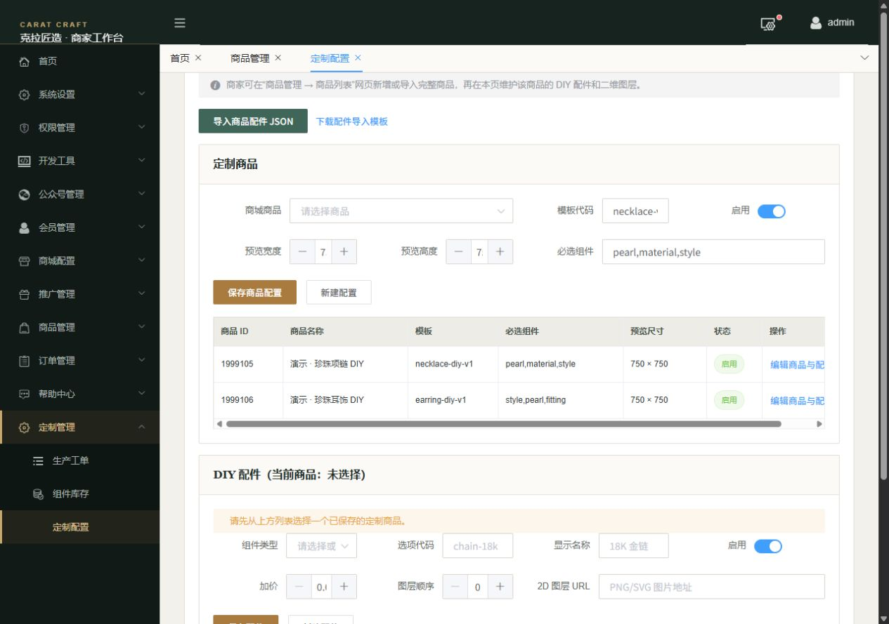
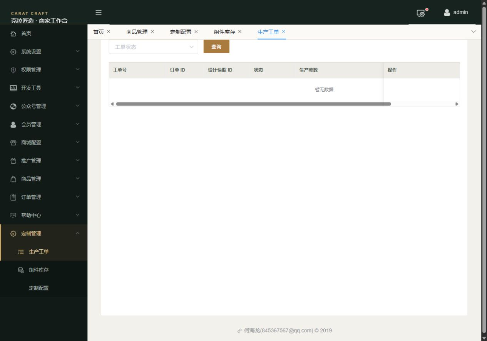

# CaratCraft 全仓审查与整体重构清单

> 此附件为版权整改前的历史审查记录. 后续文件可能已替换或移除, 当前状态见[版权整改结果](copyright-remediation-2026-10-14.md). 哈希和问题行号不应当作整改后现状.

> 审查始于2026-10-13, 登录后补查于2026-10-14, Asia/Shanghai. 基线提交: cc5bd4b49453813f68a62cfdb8841f7e0366ef38. 本轮交付为审查材料, 业务源码、许可证与历史业务数据未重构或清理. 清单项均待修复或决策.

## 1. 先看结论

项目能够编译, 本机公开商品和定制报价接口可以响应, 但不能据此视为安全商用交付. 最先处理用户越权、短信验证和匿名上传, 其次处理付款/退款/收货状态机、取消设计后重新购买以及历史配件库存引用. 品牌替换与商业分发许可应并行处理, 不宜先批量删除署名.

本次归纳 **87项**: P0 8项、P1 35项、P2 44项. 包括确认缺陷、条件性风险和设计建议, 不是87个均已在生产复现的Bug.

- [逐文件盘点](audit-2026-10-13-inventory.md): 基线1773个Git跟踪文件, 每个文件的用途、处理标签和SHA256.
- [身份、品牌、版权与工具残留](audit-2026-10-13-rights-and-residue.md): 作者、邮箱、域名、旧品牌、Agent/Qoder元数据、素材、静态库与依赖许可.
- [测试证据与复现方法](audit-2026-10-13-tests.md): 单元测试、方法/JS复现、MySQL临时表、HTTP、构建和界面边界.
- [结构化问题清单](audit-2026-10-13-findings.json): 可用于拆分重构任务, 包含证据文件、行号、建议和验收要求.

## 2. 范围与证据边界

枚举整个Git跟踪文件集, 对文本做批量内容、来源、链接与代码特征扫描, 对身份、交易、定制和部署主路径人工深读. 小程序64个JS经过Babel解析, 136个Vue模板经过现有编译器解析, 53个JSON解析通过. 22个SQL脚本检查结构、迁移和来源, 3个DOCX提取正文, 图片、字体和旧EXE/SWF盘点来源. 文件枚举不等于逐行人工证明1773个文件都没有其他缺陷.

.tools、node_modules、target、dist和运行日志也核对了用途和本地依赖元数据, 不把它们混入自有业务源码数量. 没有下载新依赖或大文件, 没有调用真实付款/退款、发送短信/邮件或修改用户/订单/商品. 页面验证码请求会正常产生临时验证码记录. MySQL复现只操作连接级临时表, 连接结束即消失.

| 证据标记 | 含义 | 不能据此宣称 |
|---|---|---|
| 源码确认 | 找到具体缺失校验、矛盾路径或配置 | 已对真实用户数据验证攻击 |
| 方法/JS复现 | 执行当前编译类/脚本, mock隔离外部依赖 | HTTP认证链、数据库事务或微信真机已验证 |
| HTTP/数据库/浏览器验证 | 本机运行实例的具体结果 | 实例严格对应本次源码; 镜像缺提交标识 |
| 设计建议/并发未执行 | 从代码和约束推导风险 | 并发故障已经实际复现 |
| 商业许可待核验 | 发现来源缺口或分发限制 | 已判定侵权, 或任意商用分发已无条件获准 |

优先级按本项目整改顺序: P0为上线/商业分发前必须处理的严重访问边界或权利缺口, P1为主要交易、数据一致性和配置阻断, P2为功能、维护、性能和体验, P3为产品决策建议. 不是CVSS评分.

## 3. 测试结果

| 检查 | 本次结果 |
|---|---|
| Java隔离单元测试 | 16用例全通过, 0失败/0错误/0跳过; biz13/API3 |
| Java管理端 | 离线compile成功, 存在模型/插件配置警告 |
| 新增隔离探针 | 8个Java场景、8个JS场景暴露异常行为, 另有1个MySQL唯一键复现 |
| 管理端lint | 154个输入文件, 5个error, 0warning; 2个no-undef、3个curly |
| 隔离生产webpack | 439资产, hasErrors=false; lint错误被降级为2条模块warning |
| 正常商品浏览 | 正确POST调用newGoods/hotGoods, HTTP200/code0 |
| 定制报价 | 合法三组报价2639.00; 空选择HTTP400/code400 |
| 公开测试接口 | 不存在测试手机号匿名HTTP200/code0/data=null, 路由确实开放 |
| 认证/方法错误 | 评论count无token为HTTP200/code401; GET访问POST路由为HTTP200/code500 |
| Docker/数据库 | 用户启动后5容器healthy; 核对schema、计数、端口及配置是否存在 |
| 外观 | 登录页、首页、商品/SKU、定制配置、库存、工单空态、订单列表已只读实测; 微信工具/真机未运行 |

初次Java测试因Windows沙箱Byte Buddy命名管道权限受阻; 用户批准后只结束本次测试子进程, 用已有javaagent与forkCount=0离线重跑成功. 旧测试报告未充当本次证据. wxParse的import造成的脚本模式解析失败, 改用Babel后已排除; wxParse动态注入事件也未登记为Bug.

## 4. 整体重构顺序

1. 封住访问边界: 统一用户归属、短信、上传和认证配置; 双用户、匿名、缺参数、负数和重放进入回归.
2. 收敛交易状态机: 统一订单、付款、退款、库存、优惠券和工单业务服务; 补幂等、条件更新与对账补偿后再进行真实微信联调.
3. 建立版本化定制模型: 设计快照与组件/BOM版本独立于当前可售配置; 取消重购与历史退款可追溯; 预览与报价消费同一配置.
4. 修正运行、迁移和构建: 统一环境schema, 旧数据升级有台账, 质量门禁不忽略error; 依赖升级另外制定兼容计划.
5. 品牌与权利清理并行: 查清Highcharts与素材授权, 清理无关品牌、工具缓存与不用模块, 根据实际发布物生成许可清单.
6. 界面与文档验收: 在已完成后台只读检查的基础上, 补微信工具/真机与隔离数据集操作验证, 逐页验收购买、定制、订单、售后和工单; 文档只描述有证据的能力.

这是待确认的重构顺序, 本轮没有实施代码修改. 删除业务数据、升级依赖、真实支付和替换许可证不在本次审查实施范围内.

## 5. 全部问题

| 编号 | 优先级 | 类别 | 问题 |
|---|---|---|---|
| [A001](#a001) | P0 | 权限与隐私 | 修改地址时可以覆盖其他用户的地址 |
| [A002](#a002) | P0 | 权限与隐私 | 购物车更新越权, 合并分支还会删除其他人的记录 |
| [A003](#a003) | P0 | 权限与隐私 | 匿名手机号授权接口可以修改指定用户 |
| [A004](#a004) | P0 | 权限与隐私 | 公开测试接口可以按手机号返回用户实体 |
| [A005](#a005) | P0 | 权限与隐私 | 旧短信接口把验证码直接返回客户端 |
| [A006](#a006) | P0 | 权限与隐私 | 短信验证码没有绑定实际接收手机号 |
| [A007](#a007) | P1 | 权限与隐私 | 新用户领券只检查验证码非空 |
| [A008](#a008) | P0 | 权限与隐私 | 匿名任意文件上传与同域托管 |
| [A009](#a009) | P1 | 权限与隐私 | 默认JWT密钥无法签发token |
| [A010](#a010) | P1 | 权限与隐私 | 认证与会话秘密可能写入日志 |
| [A011](#a011) | P2 | 权限与隐私 | CORS信任任意Origin且预检与token请求头不一致 |
| [A012](#a012) | P2 | 权限与隐私 | 生产文档与监控入口缺少明确的关闭边界 |
| [A013](#a013) | P1 | 订单与支付 | 小程序预支付使用公众号openid字段 |
| [A014](#a014) | P1 | 订单与支付 | 预支付失败后订单可能无法取消或超时关闭 |
| [A015](#a015) | P1 | 订单与支付 | 支付落库缺少订单级条件更新 |
| [A016](#a016) | P1 | 订单与支付 | 支付更新失败仍生成定制工单 |
| [A017](#a017) | P1 | 订单与支付 | 任意订单状态可以确认收货 |
| [A018](#a018) | P1 | 订单与支付 | 已收货退款与DAO条件冲突 |
| [A019](#a019) | P1 | 订单与支付 | 退款接受与退款完成混用, 缺少对账补偿 |
| [A020](#a020) | P1 | 订单与支付 | 发货未受定制工单完成状态约束 |
| [A021](#a021) | P1 | 订单与支付 | 后台通用订单修改和删除可绕过业务约束 |
| [A022](#a022) | P1 | 订单与支付 | 改价允许零元且缺少精度/状态一致性约束 |
| [A023](#a023) | P1 | 订单与支付 | 结算双击重复提交且后端无普通订单幂等键 |
| [A024](#a024) | P1 | 订单与支付 | 支付预下单网络失败会让Promise一直待定 |
| [A025](#a025) | P2 | 订单与支付 | 结算和提交的优惠券、价格口径不统一 |
| [A026](#a026) | P2 | 订单与支付 | 购买上下文按用户单一Redis键且没有有效期 |
| [A027](#a027) | P1 | 定制与库存 | 取消设计恢复草稿, 但唯一约束禁止重新绑定 |
| [A028](#a028) | P1 | 定制与库存 | 替换配件和删除选项破坏历史快照及库存恢复 |
| [A029](#a029) | P1 | 定制与库存 | 新增/导入配件没有同步初始化库存 |
| [A030](#a030) | P1 | 定制与库存 | 工单更新没有条件锁且状态与日志不在同一事务 |
| [A031](#a031) | P2 | 定制与库存 | cancelOrder对CANCELLED没有显式幂等防线 |
| [A032](#a032) | P2 | 定制与库存 | 绝对设置库存可能覆盖并发销售扣减 |
| [A033](#a033) | P2 | 定制与库存 | 只有同组互斥与必选, 没有跨组件工艺规则 |
| [A034](#a034) | P1 | 定制与库存 | 定制必选组硬编码, 不服从商家配置 |
| [A035](#a035) | P1 | 定制与库存 | 商家图层配置没有用于最终预览 |
| [A036](#a036) | P1 | 定制与库存 | 报价失败后保留旧价格和可点击下一步 |
| [A037](#a037) | P1 | 定制与库存 | 加载商品配置的响应乱序可以混入其他商品选项 |
| [A038](#a038) | P2 | 定制与库存 | 编辑草稿实际创建新快照, 缺少预览固化和删除入口 |
| [A039](#a039) | P2 | 定制与库存 | 导入模板仍使用已清理的旧商品ID且缺少必选style |
| [A040](#a040) | P1 | 前端功能与接口 | 合法商品JSON导入必然报未定义data |
| [A041](#a041) | P1 | 前端功能与接口 | 小程序请求失败未关闭loading, 并发请求也互相关闭 |
| [A042](#a042) | P2 | 前端功能与接口 | 401导航重复且未清理旧token |
| [A043](#a043) | P2 | 前端功能与接口 | 购物车数量允许零/负数, SKU与商品未始终绑定 |
| [A044](#a044) | P2 | 前端功能与接口 | 地址默认值空指针, 默认地址唯一性与输入校验缺失 |
| [A045](#a045) | P2 | 前端功能与接口 | 地址返回页面时请求早于读取已选addressId |
| [A046](#a046) | P2 | 前端功能与接口 | 旧账号登录/注册/重置页面与接口不一致 |
| [A047](#a047) | P2 | 前端功能与接口 | 地址页绑定缺失事件, 旧备用更新入口引用未定义util |
| [A048](#a048) | P2 | 前端功能与接口 | 匿名评论数量接口不匿名, 评论总数与过滤条件不一致 |
| [A049](#a049) | P2 | 前端功能与接口 | 评论奖励判断包含刚插入的本人评论 |
| [A050](#a050) | P2 | 前端功能与接口 | 异常HTTP状态与业务码不一致 |
| [A051](#a051) | P2 | 前端功能与接口 | 富文本预览直接启用HTML解释 |
| [A052](#a052) | P1 | 部署与数据 | Compose未注入支付和公众号相关环境变量 |
| [A053](#a053) | P1 | 部署与数据 | Redis密码配置与服务启动不一致 |
| [A054](#a054) | P1 | 部署与数据 | 数据库使用root弱默认且数据库/Redis公开所有网卡 |
| [A055](#a055) | P1 | 部署与数据 | ResetData还会删除上传图片卷 |
| [A056](#a056) | P1 | 部署与数据 | 迁移没有执行台账, 当前数据库仍启用旧耳饰 |
| [A057](#a057) | P1 | 部署与数据 | 旧目录清理通过ID段识别并批量删除所有品牌/专题/帮助 |
| [A058](#a058) | P2 | 部署与数据 | 前端API与上传域名默认localhost, 多入口环境漂移 |
| [A059](#a059) | P2 | 部署与数据 | Nginx默认请求体限制与上传文档冲突 |
| [A060](#a060) | P2 | 部署与数据 | 健康检查只看端口, 没有业务依赖就绪和构建版本 |
| [A061](#a061) | P2 | 部署与数据 | 商城订单用户关联表与实际登录用户来源不一致 |
| [A062](#a062) | P2 | 架构与性能 | 核心业务集中大控制器, 服务边界没有统一 |
| [A063](#a063) | P2 | 架构与性能 | 工单、设计和组件库存查询缺少分页或全量读取 |
| [A064](#a064) | P2 | 架构与性能 | 旧Redis类型配置与宽泛反序列化增加维护/安全成本 |
| [A065](#a065) | P2 | 构建与规范 | 生产构建把lint错误降级成警告, 缺少质量门禁 |
| [A066](#a066) | P2 | 构建与规范 | Maven配置混合版本与错误BOM位置 |
| [A067](#a067) | P2 | 构建与规范 | 前端旧工具链和无用下载型依赖 |
| [A068](#a068) | P2 | 构建与规范 | 函数注释与代码风格没有统一检查 |
| [A069](#a069) | P2 | 构建与规范 | 危险集成测试没有硬隔离, 核心缺少真实DB并发测试 |
| [A070](#a070) | P2 | 文档与残留 | 旧AI文档与项目约束大量过期 |
| [A071](#a071) | P2 | 文档与残留 | 根README把部分未完整闭环行为描述为已完成 |
| [A072](#a072) | P2 | 文档与残留 | 旧README20个图片链接失效, 两份开发DOCX完全重复 |
| [A073](#a073) | P2 | 文档与残留 | 临时停止脚本与小程序个人配置被跟踪 |
| [A074](#a074) | P2 | 文档与残留 | 旧商城、工作流与富文本整包残留需要按依赖删减 |
| [A075](#a075) | P2 | 外观与体验 | 新品牌原图未接入, 产品仍使用绿色旧logo |
| [A076](#a076) | P2 | 外观与体验 | 登录页标题和页脚仍不专业, 控件缺可访问标签 |
| [A077](#a077) | P2 | 外观与体验 | 首页优先服务器监控, 偏离商家工作台 |
| [A078](#a078) | P2 | 外观与体验 | 首页“演示”标签与真实商品数据未绑定 |
| [A079](#a079) | P2 | 外观与体验 | 工单界面暴露JSON/所有状态, 缺少生产可用信息 |
| [A080](#a080) | P2 | 外观与体验 | 窄窗口图表重叠和字段裁切, 缺少统一视觉验收 |
| [A081](#a081) | P0 | 版权与自有化 | Highcharts并不是由底座Apache许可覆盖的免费商用组件 |
| [A082](#a082) | P1 | 版权与自有化 | “全部改成自己的署名”不能建立第三方权利 |
| [A083](#a083) | P1 | 版权与自有化 | 图片、字体、EXE/SWF与依赖缺少商用权利台账 |
| [A084](#a084) | P1 | 版权与AI工具残留 | 无关品牌/域名与AI工具残留需按用途处理 |
| [A085](#a085) | P1 | 版权与自有化 | 商业源码/二进制分发不能忽略数据库驱动和多许可依赖 |
| [A086](#a086) | P2 | 外观与体验 | 监控字段误标已用/可用和逻辑/物理处理器 |
| [A087](#a087) | P2 | 前端功能与接口 | 登录跳转产生未处理的路由NavigationFailure |

## 权限与隐私

### A001 [P0] 修改地址时可以覆盖其他用户的地址

**证据级别**: 源码确认 + 方法复现. **定位**: [vendor/platform-wxshop/platform-api/src/main/java/com/platform/modules/app/controller/AppAddressController.java:72](../vendor/platform-wxshop/platform-api/src/main/java/com/platform/modules/app/controller/AppAddressController.java).

**问题与影响**: save 接受客户端地址 id, 强行把 userId 设成当前用户, Service 只执行 updateById. 方法级 mock 复现 id=99 被直接更新为用户7, 未查询原归属.

**重构建议**: 更新必须以 id+当前用户ID 为条件, 不允许通过更新改变地址归属.

**验收要求**: 用户A更新用户B地址返回403/404, B的字段完全不变.

### A002 [P0] 购物车更新越权, 合并分支还会删除其他人的记录

**证据级别**: 源码确认 + 方法复现. **定位**: [vendor/platform-wxshop/platform-api/src/main/java/com/platform/modules/app/controller/AppCartController.java:267](../vendor/platform-wxshop/platform-api/src/main/java/com/platform/modules/app/controller/AppCartController.java).

**问题与影响**: update 未校验 cartInfo.userId. 更换规格的查询还遗漏 userId, 然后 delete(newcartInfo.id). 已用当前编译类复现用户7更新用户8的购物车.

**重构建议**: 所有读写和合并条件绑定当前用户, 在事务中核验商品与SKU对应关系.

**验收要求**: 双用户同SKU场景不能跨用户更新、合并或删除.

### A003 [P0] 匿名手机号授权接口可以修改指定用户

**证据级别**: 源码确认. **定位**: [vendor/platform-wxshop/platform-api/src/main/java/com/platform/modules/app/controller/AppLoginController.java:151](../vendor/platform-wxshop/platform-api/src/main/java/com/platform/modules/app/controller/AppLoginController.java).

**问题与影响**: LoginByMaPhone 带 IgnoreAuth, userId 来自请求. 有效微信手机号 code 不代表调用者可以修改任意用户.

**重构建议**: 要求当前登录态, 用户ID只来自token, 校验授权code用途和应用.

**验收要求**: 传入其他userId无法改变任何他人手机号.

### A004 [P0] 公开测试接口可以按手机号返回用户实体

**证据级别**: 源码确认 + HTTP验证. **定位**: [vendor/platform-wxshop/platform-api/src/main/java/com/platform/modules/app/controller/AppTestController.java:60](../vendor/platform-wxshop/platform-api/src/main/java/com/platform/modules/app/controller/AppTestController.java).

**问题与影响**: userListByMobile 为 IgnoreAuth, 直接返回包含手机号、openid、unionId、登录IP等的实体. 对不存在的测试手机号, 运行接口匿名HTTP200/code0. 未调用真实手机号读取隐私.

**重构建议**: 生产环境移除测试控制器, 测试功能限定测试profile和权限.

**验收要求**: 生产路由无该接口, 匿名请求不返回用户资料.

### A005 [P0] 旧短信接口把验证码直接返回客户端

**证据级别**: 源码确认. **定位**: [vendor/platform-wxshop/platform-api/src/main/java/com/platform/modules/app/controller/AppSmsController.java:159](../vendor/platform-wxshop/platform-api/src/main/java/com/platform/modules/app/controller/AppSmsController.java).

**问题与影响**: /api/sendSms 返回生成的验证码, 而且不在 /app/** 认证拦截范围内. 在配置有效时, 手机验证秘密被作为响应数据泄露.

**重构建议**: 删除或统一旧接口, 只返回发送结果, 不返回验证码; 限制发送频率与验证尝试.

**验收要求**: 所有短信响应和日志均不出现验证码, 未验证不能完成绑定.

### A006 [P0] 短信验证码没有绑定实际接收手机号

**证据级别**: 源码确认 + 方法复现. **定位**: [vendor/platform-wxshop/platform-api/src/main/java/com/platform/modules/app/controller/AppUserController.java:56](../vendor/platform-wxshop/platform-api/src/main/java/com/platform/modules/app/controller/AppUserController.java).

**问题与影响**: 发送和验证均只按用户ID缓存验证码, 验证记录不包含phone. 已复现有效缓存code可以绑定请求中的另一个手机号.

**重构建议**: 缓存用户、手机号、用途、有效期和尝试次数, 核验完整上下文并原子消费.

**验收要求**: 发给手机号A的code绑定B必须失败, 重放也必须失败.

### A007 [P1] 新用户领券只检查验证码非空

**证据级别**: 源码确认. **定位**: [vendor/platform-wxshop/platform-api/src/main/java/com/platform/modules/app/controller/AppCouponController.java:157](../vendor/platform-wxshop/platform-api/src/main/java/com/platform/modules/app/controller/AppCouponController.java).

**问题与影响**: newuser 没有读取Redis校验code, 直接写入phone并发券. 无事务, 发券失败也可能已改变用户手机号.

**重构建议**: 复用统一短信验证服务, 校验后在事务中领取, 增加唯一领取约束.

**验收要求**: 任意非空code不能改手机号或领券, 重复并发请求只发一次.

### A008 [P0] 匿名任意文件上传与同域托管

**证据级别**: 源码确认, 上传未执行. **定位**: [vendor/platform-wxshop/platform-api/src/main/java/com/platform/modules/app/controller/AppUploadController.java:53](../vendor/platform-wxshop/platform-api/src/main/java/com/platform/modules/app/controller/AppUploadController.java).

**问题与影响**: upload/uploadFiles 为匿名, 从文件名取任意后缀, 读取全部字节, 未做文件内容白名单. 后台上传同样缺少服务端类型和5MB限制. Nginx同域公开 /upload/. HTML/SVG等主动内容存在条件性同源脚本风险.

**重构建议**: 要求登录与用途权限, 服务端检测类型/大小/内容, 图片转码; 独立静态资源域并配置安全响应头.

**验收要求**: 无登录拒绝上传; HTML伪装图片、超限、多文件总量均拒绝; 存储内容不能执行脚本.

### A009 [P1] 默认JWT密钥无法签发token

**证据级别**: 源码确认 + 方法复现. **定位**: [vendor/platform-wxshop/platform-api/src/main/java/com/platform/utils/JwtUtils.java:80](../vendor/platform-wxshop/platform-api/src/main/java/com/platform/utils/JwtUtils.java).

**问题与影响**: Compose显式注入空JWT_SECRET; 缺失时YAML默认字符串也不是有效强HS256密钥. 实测空值为IllegalArgumentException, 默认字符串为WeakKeyException. 当前API容器环境JWT为空.

**重构建议**: 启动时校验合法Base64随机密钥和至少256位强度, 失败给出配置错误, 环境示例说明生成方式.

**验收要求**: 空值和弱值在启动时失败且提示明确, 合法密钥能签发并验证token.

### A010 [P1] 认证与会话秘密可能写入日志

**证据级别**: 源码确认. **定位**: [vendor/platform-wxshop/platform-api/src/main/java/com/platform/modules/app/controller/AppLoginController.java:91](../vendor/platform-wxshop/platform-api/src/main/java/com/platform/modules/app/controller/AppLoginController.java).

**问题与影响**: 登录打印sessionData; JwtUtils在解析错误时打印完整token; SysLogAspect序列化所有请求参数, 密码更新/配置内容可能被记录.

**重构建议**: 采用敏感字段屏蔽, 日志只保留追踪ID和错误类别, 增加保留期.

**验收要求**: 令牌、session_key、密码、验证码、商户密钥不出现在日志或审计记录.

### A011 [P2] CORS信任任意Origin且预检与token请求头不一致

**证据级别**: 源码确认. **定位**: [vendor/platform-wxshop/platform-api/src/main/java/com/platform/interceptor/AuthorizationInterceptor.java:58](../vendor/platform-wxshop/platform-api/src/main/java/com/platform/interceptor/AuthorizationInterceptor.java).

**问题与影响**: 反射Origin并允许credentials, Allow-Headers不包含token; 对OPTIONS未明确放行. 同源小程序不一定触发, Web客户端或跨域部署存在风险.

**重构建议**: 统一显式来源白名单, 预检由框架处理, token头与实际客户端一致.

**验收要求**: 不允许来源被拒绝, 合法浏览器跨域token预检与实际请求通过.

### A012 [P2] 生产文档与监控入口缺少明确的关闭边界

**证据级别**: 源码确认 + 部分HTTP验证. **定位**: [vendor/platform-wxshop/platform-admin/src/main/java/com/platform/config/ShiroConfig.java:83](../vendor/platform-wxshop/platform-admin/src/main/java/com/platform/config/ShiroConfig.java).

**问题与影响**: Shiro对Druid和OpenAPI匿名; prod YAML默认开启Druid并设置弱示例密码. 当前API /v3/api-docs匿名HTTP200; 当前Druid返回业务404, 尚未证明当前实例暴露监控.

**重构建议**: 生产显式关闭或鉴权, 运维端口限制访问, 删除生产弱默认值.

**验收要求**: 生产匿名不访问完整API文档与数据库监控, 内部运维可受控访问.

## 订单与支付

### A013 [P1] 小程序预支付使用公众号openid字段

**证据级别**: 源码确认. **定位**: [vendor/platform-wxshop/platform-api/src/main/java/com/platform/modules/app/controller/AppPayController.java:128](../vendor/platform-wxshop/platform-api/src/main/java/com/platform/modules/app/controller/AppPayController.java).

**问题与影响**: 小程序登录写maOpenid, 预支付却取openid. 当前WX_USER与商城用户是不同来源, 仅小程序登录用户通常无法获得正确JSAPI付款标识.

**重构建议**: 按支付应用选取maOpenid, 校验appid与openid所属应用.

**验收要求**: 只有maOpenid的小程序用户可以正常预下单, 不混用公众号用户标识.

### A014 [P1] 预支付失败后订单可能无法取消或超时关闭

**证据级别**: 源码确认 + 当前数据核对. **定位**: [vendor/platform-wxshop/platform-api/src/main/java/com/platform/modules/app/controller/AppPayController.java:133](../vendor/platform-wxshop/platform-api/src/main/java/com/platform/modules/app/controller/AppPayController.java).

**问题与影响**: 创建预支付即把payStatus写为1; 用户取消付款后没有恢复, cancelUnpaid SQL和OrderTimeoutTask均只处理payStatus=0.

**重构建议**: 分离预支付创建与已付款状态, 关单前向支付方核对, 包括支付中状态.

**验收要求**: 取消付款/关闭微信后订单可以取消并按策略超时关闭, 已付款不误关.

### A015 [P1] 支付落库缺少订单级条件更新

**证据级别**: 源码确认, 并发未执行. **定位**: [vendor/platform-wxshop/platform-biz/src/main/java/com/platform/modules/mall/service/impl/OrderPaymentServiceImpl.java:48](../vendor/platform-wxshop/platform-biz/src/main/java/com/platform/modules/mall/service/impl/OrderPaymentServiceImpl.java).

**问题与影响**: markPaid先读再无条件update. 与取消、改价、预支付请求并发时可能覆盖新状态; 定制绑定的条件更新不能代替商城订单的条件更新.

**重构建议**: 统一订单状态机, 更新时限定原状态/版本, 核验影响行数并处理冲突.

**验收要求**: 支付与取消/改价并发后订单、库存、券和工单始终一致.

### A016 [P1] 支付更新失败仍生成定制工单

**证据级别**: 源码确认 + 方法复现. **定位**: [vendor/platform-wxshop/platform-biz/src/main/java/com/platform/modules/mall/service/impl/OrderPaymentServiceImpl.java:50](../vendor/platform-wxshop/platform-biz/src/main/java/com/platform/modules/mall/service/impl/OrderPaymentServiceImpl.java).

**问题与影响**: 忽略orderService.update的返回值. mock其返回false后, markOrderPaid仍被调用且无异常.

**重构建议**: 更新未命中必须回滚, 由同一服务原子执行订单与工单状态变化.

**验收要求**: 订单更新失败不生成工单, 支付回调返回可重试失败.

### A017 [P1] 任意订单状态可以确认收货

**证据级别**: 源码确认 + 方法复现. **定位**: [vendor/platform-wxshop/platform-api/src/main/java/com/platform/modules/app/controller/AppOrderController.java:299](../vendor/platform-wxshop/platform-api/src/main/java/com/platform/modules/app/controller/AppOrderController.java).

**问题与影响**: confirmOrder只核验本人, 没核验已支付和已发货. 已复现待付款0/0订单变成301且shippingStatus=2.

**重构建议**: 仅允许已支付且已发货订单, 用条件SQL/版本约束更新.

**验收要求**: 未支付、未发货、取消、退款订单不能确认收货, 重复确认幂等.

### A018 [P1] 已收货退款与DAO条件冲突

**证据级别**: 源码确认. **定位**: [vendor/platform-wxshop/platform-biz/src/main/java/com/platform/modules/mall/dao/MallOrderDao.java:72](../vendor/platform-wxshop/platform-biz/src/main/java/com/platform/modules/mall/dao/MallOrderDao.java).

**问题与影响**: refund控制器允许300和301退款到402, DAO只允许300. 301退款可能已被微信接受, 本地更新再失败.

**重构建议**: 明确已收货售后策略, 统一状态约束, 退款申请、处理中、完成分开.

**验收要求**: 301售后按策略完整落库或在调用外部退款前明确拒绝.

### A019 [P1] 退款接受与退款完成混用, 缺少对账补偿

**证据级别**: 设计缺陷, 真实支付未验证. **定位**: [vendor/platform-wxshop/platform-api/src/main/java/com/platform/modules/app/controller/AppPayController.java:293](../vendor/platform-wxshop/platform-api/src/main/java/com/platform/modules/app/controller/AppPayController.java).

**问题与影响**: 调用退款返回SUCCESS后立即恢复资源. 外部付款系统和本地事务不能原子提交; 本地更新失败时缺少退款状态查询、回调和补偿记录.

**重构建议**: 引入退款单/请求ID、异步状态、查询/通知和可重试补偿, 不以接受请求等同结算完成.

**验收要求**: 外部成功但本地失败能恢复一致; 重复通知、延迟通知不重复返库存.

### A020 [P1] 发货未受定制工单完成状态约束

**证据级别**: 源码确认. **定位**: [vendor/platform-wxshop/platform-admin/src/main/java/com/platform/modules/mall/controller/MallOrderController.java:160](../vendor/platform-wxshop/platform-admin/src/main/java/com/platform/modules/mall/controller/MallOrderController.java).

**问题与影响**: ship只检查payStatus和shippingStatus, 未检查订单状态完整合法性或对应工单COMPLETED, 仍以读后updateById更新.

**重构建议**: 发货由业务服务核验订单和工单, 原子流转并记录操作者.

**验收要求**: 制作中/质检未通过/退款处理中不能发货, 并发操作不覆盖退款.

### A021 [P1] 后台通用订单修改和删除可绕过业务约束

**证据级别**: 源码确认. **定位**: [vendor/platform-wxshop/platform-admin/src/main/java/com/platform/modules/mall/controller/MallOrderController.java:257](../vendor/platform-wxshop/platform-admin/src/main/java/com/platform/modules/mall/controller/MallOrderController.java).

**问题与影响**: 通用update和deleteBatch暴露实体/物理删除路径, 未统一经过支付、库存、券与定制状态服务; 已支付订单删除会破坏关联和追溯.

**重构建议**: 缩窄更新DTO, 金额/状态只走专用服务, 订单归档与删除策略区分.

**验收要求**: 普通编辑不能直接改付款/订单状态; 活跃订单不能物理删除.

### A022 [P1] 改价允许零元且缺少精度/状态一致性约束

**证据级别**: 源码确认. **定位**: [vendor/platform-wxshop/platform-admin/src/main/java/com/platform/modules/mall/controller/MallOrderController.java:229](../vendor/platform-wxshop/platform-admin/src/main/java/com/platform/modules/mall/controller/MallOrderController.java).

**问题与影响**: adjustPrice允许0, 仅检查payStatus=0; 可改取消状态订单, 没限制两位小数, 直接同步orderPrice但不维护goodsPrice/couponPrice账务关系.

**重构建议**: 明确最低金额、两位小数、待付款状态和改价流水; 作条件更新.

**验收要求**: 零元或过高精度被拒绝, 改价前后账单可解释, 已取消不能改价.

### A023 [P1] 结算双击重复提交且后端无普通订单幂等键

**证据级别**: 源码确认 + JS复现. **定位**: [vendor/platform-wxshop/wx-mall/pages/shopping/checkout/checkout.js:183](../vendor/platform-wxshop/wx-mall/pages/shopping/checkout/checkout.js).

**问题与影响**: 按钮无submitting状态; 双调用实测发2次请求. 商品/购物车资源竞争不等于业务幂等, 普通立即购买Redis上下文并非原子消费.

**重构建议**: 客户端提交中禁用, 服务端订单幂等键和事务约束, 持久化结果供重试读取.

**验收要求**: 同幂等键并发/超时重试只产生一笔订单并只扣一次资源.

### A024 [P1] 支付预下单网络失败会让Promise一直待定

**证据级别**: 源码确认 + JS复现. **定位**: [vendor/platform-wxshop/wx-mall/services/pay.js:13](../vendor/platform-wxshop/wx-mall/services/pay.js).

**问题与影响**: 外层new Promise没有接住内部util.request拒绝. 实测网络失败40ms后外层未settle且有未处理rejection.

**重构建议**: 直接返回Promise链, 统一错误处理; 支付客户端成功后查询服务端真实状态.

**验收要求**: 网络失败能结束loading并进入可恢复错误态, 不把未知结果当支付成功.

### A025 [P2] 结算和提交的优惠券、价格口径不统一

**证据级别**: 源码确认. **定位**: [vendor/platform-wxshop/platform-api/src/main/java/com/platform/modules/app/controller/AppCartController.java:470](../vendor/platform-wxshop/platform-api/src/main/java/com/platform/modules/app/controller/AppCartController.java).

**问题与影响**: checkout读取优惠券面额而未复用提交的有效期/门槛/最低0.01限制; 定制列表按SKU价算优惠门槛, 不按定制报价. 前端最低显示0, 后端至少0.01.

**重构建议**: 预览与提交共用报价/优惠服务, 展示服务器有效报价和变化确认.

**验收要求**: 过期券/门槛不符/面额超过金额时预览与下单完全一致.

### A026 [P2] 购买上下文按用户单一Redis键且没有有效期

**证据级别**: 设计缺陷. **定位**: [vendor/platform-wxshop/platform-api/src/main/java/com/platform/modules/app/controller/AppBuyController.java:61](../vendor/platform-wxshop/platform-api/src/main/java/com/platform/modules/app/controller/AppBuyController.java).

**问题与影响**: 同一用户多页面/多设备购买共用goods+userId键; 后一次覆盖前一次, 未指定TTL; DB事务内删除Redis不能随DB回滚.

**重构建议**: 使用每次结算唯一ID、过期时间和幂等提交记录, 明确跨存储提交顺序.

**验收要求**: 两个结算各自保持商品/设计, 数据库失败后可正确重试.

## 定制与库存

### A027 [P1] 取消设计恢复草稿, 但唯一约束禁止重新绑定

**证据级别**: 源码确认 + MySQL临时表复现. **定位**: [vendor/platform-wxshop/platform-biz/src/main/java/com/platform/modules/custom/service/impl/CustomDesignServiceImpl.java:64](../vendor/platform-wxshop/platform-biz/src/main/java/com/platform/modules/custom/service/impl/CustomDesignServiceImpl.java).

**问题与影响**: 未付款取消把snapshot恢复DRAFT, 保留旧CANCELLED绑定. CC_ORDER_CUSTOMIZATION对snapshot_id唯一. 同结构MySQL临时表实测第二次绑定ERROR1062.

**重构建议**: 设计版本与购买实例分离, 或安全复用绑定/新增副本; 保留历史订单可追溯.

**验收要求**: 同一取消设计再次购买成功, 新旧订单和工单关系唯一且可追溯.

### A028 [P1] 替换配件和删除选项破坏历史快照及库存恢复

**证据级别**: 源码确认. **定位**: [vendor/platform-wxshop/platform-admin/src/main/java/com/platform/modules/custom/controller/CustomConfigurationController.java:196](../vendor/platform-wxshop/platform-admin/src/main/java/com/platform/modules/custom/controller/CustomConfigurationController.java).

**问题与影响**: 导入物理删除旧选项后创建新ID; 删除选项同时删库存. 快照只保存optionIds, 退款restoreByOptionId依赖当前选项INNER JOIN, 删除后恢复0行且结果被忽略.

**重构建议**: 选项版本化/软停用, 快照固化组件代码、名称、数量、工艺与价格; 库存以稳定组件ID记账.

**验收要求**: 历史订单编辑、取消、退款不依赖当前可售选项; 恢复数量准确且有流水.

### A029 [P1] 新增/导入配件没有同步初始化库存

**证据级别**: 源码确认. **定位**: [vendor/platform-wxshop/platform-admin/src/main/java/com/platform/modules/custom/controller/CustomConfigurationController.java:131](../vendor/platform-wxshop/platform-admin/src/main/java/com/platform/modules/custom/controller/CustomConfigurationController.java).

**问题与影响**: saveOption/import只保存配件, quote要求库存记录存在且>0. 新配件即使enabled=1也不可报价; 替换导入留下旧库存孤儿.

**重构建议**: 配置导入包含库存策略或明确发布前待补库存; 同事务维护库存键.

**验收要求**: 新导入组件可按预期发布; 旧库存不被误用, 孤儿可解释.

### A030 [P1] 工单更新没有条件锁且状态与日志不在同一事务

**证据级别**: 源码确认, 并发未执行. **定位**: [vendor/platform-wxshop/platform-admin/src/main/java/com/platform/modules/custom/controller/CustomWorkOrderController.java:98](../vendor/platform-wxshop/platform-admin/src/main/java/com/platform/modules/custom/controller/CustomWorkOrderController.java).

**问题与影响**: 校验读取的旧状态后updateById; 无Transactional. 并发制作与退款取消可覆盖状态, 日志插入失败时状态已改; 服务端取消未写同类工单日志.

**重构建议**: 状态机移到service, 原状态条件更新, 状态与日志同事务, 所有取消路径记录.

**验收要求**: 并发只允许一个合法流转, 失败不留下无日志状态变更.

### A031 [P2] cancelOrder对CANCELLED没有显式幂等防线

**证据级别**: 源码确认. **定位**: [vendor/platform-wxshop/platform-biz/src/main/java/com/platform/modules/custom/service/impl/CustomDesignServiceImpl.java:260](../vendor/platform-wxshop/platform-biz/src/main/java/com/platform/modules/custom/service/impl/CustomDesignServiceImpl.java).

**问题与影响**: 服务再次读取CANCELLED时仍尝试CANCELLED到CANCELLED更新并恢复组件库存. 上游订单CAS可阻断部分路径, 但服务本身非完整幂等. 现有测试把第二次update固定mock为0, 不能验证真实SQL.

**重构建议**: 仅允许LOCKED/PAID转CANCELLED, 校验合法原状态; 用真实数据库并发验证.

**验收要求**: 直接重复调用取消服务也只恢复一次组件库存.

### A032 [P2] 绝对设置库存可能覆盖并发销售扣减

**证据级别**: 源码确认. **定位**: [vendor/platform-wxshop/platform-biz/src/main/java/com/platform/modules/custom/service/impl/CustomStockServiceImpl.java:73](../vendor/platform-wxshop/platform-biz/src/main/java/com/platform/modules/custom/service/impl/CustomStockServiceImpl.java).

**问题与影响**: 管理员直接设置剩余数量, 未做版本校验或库存流水; 读后写/插入还可能并发触发唯一冲突.

**重构建议**: 采用盘点差额/版本号或库存流水, 记录原因与操作者.

**验收要求**: 盘点和下单并发不丢失扣减, 历史库存变化可以追溯.

### A033 [P2] 只有同组互斥与必选, 没有跨组件工艺规则

**证据级别**: 源码确认. **定位**: [vendor/platform-wxshop/platform-biz/src/main/java/com/platform/modules/custom/service/impl/CustomQuoteServiceImpl.java:98](../vendor/platform-wxshop/platform-biz/src/main/java/com/platform/modules/custom/service/impl/CustomQuoteServiceImpl.java).

**问题与影响**: 任意不同组组合均可报价, fitting组永远只能一项; 珍珠尺寸、材质、款式、宝石之间没有兼容规则或用量BOM. 业务蓝图的“校验组合”目前范围很窄.

**重构建议**: 先定义可生产组合和BOM, 按真实库存单位报价与扣减, 再实现版本化规则.

**验收要求**: 不可生产组合被服务端拒绝, 双珠款扣正确珍珠数量, 多配件规则清楚.

### A034 [P1] 定制必选组硬编码, 不服从商家配置

**证据级别**: 源码确认. **定位**: [vendor/platform-wxshop/wx-mall/pages/designer/designer.js:67](../vendor/platform-wxshop/wx-mall/pages/designer/designer.js).

**问题与影响**: required由前端固定三组决定, 不读requiredComponentTypes. 商家新增必选length会被显示“可选”, 服务端又拒绝; 原配置或其他模板也不一致.

**重构建议**: 配置结构明确required/primary/可多选, 页面由服务器配置生成.

**验收要求**: 更换必选组不改前端就能使用, 页面对必选/可选描述与服务一致.

### A035 [P1] 商家图层配置没有用于最终预览

**证据级别**: 源码确认 + JS复现. **定位**: [vendor/platform-wxshop/wx-mall/pages/designer/designer.js:267](../vendor/platform-wxshop/wx-mall/pages/designer/designer.js).

**问题与影响**: resolvePreviewLayers依赖optionCode猜图片, 忽略实际assetUrl、zIndex、预览尺寸. S925银选项实测仍使用white-gold. 后台“2D图层URL”只影响选项缩略图.

**重构建议**: 以经过验证的图层配置渲染, 占位图明确标注未配置, 不用材质猜测替代真实配置.

**验收要求**: 后台更换图层和顺序能改变预览; 银/长度/刻字预览能力与文案一致.

### A036 [P1] 报价失败后保留旧价格和可点击下一步

**证据级别**: 源码确认 + JS复现. **定位**: [vendor/platform-wxshop/wx-mall/pages/designer/designer.js:331](../vendor/platform-wxshop/wx-mall/pages/designer/designer.js).

**问题与影响**: 刷新报价只处理成功, 未清空旧quote、无失败提示/catch. 缺货/无效组合实测仍保留199报价, 下一步disabled仍可能为false.

**重构建议**: 新增quoting/error状态, 变更即失效旧报价, 最新合法报价关联配置指纹.

**验收要求**: 配置非法或网络失败不能用旧价格继续, 错误可见并可重试.

### A037 [P1] 加载商品配置的响应乱序可以混入其他商品选项

**证据级别**: 源码确认 + JS复现. **定位**: [vendor/platform-wxshop/wx-mall/pages/designer/designer.js:36](../vendor/platform-wxshop/wx-mall/pages/designer/designer.js).

**问题与影响**: 报价有seq但loadConfig没有. 实测goodsId=2最终productConfig.goodsId=1、SKU=11. 可导致错误预览/下单失败.

**重构建议**: 配置请求使用序号/商品ID校验, 取消旧请求, 页面卸载清理计时器.

**验收要求**: 快速切商品与恢复快照时商品ID、选项、SKU和报价始终匹配.

### A038 [P2] 编辑草稿实际创建新快照, 缺少预览固化和删除入口

**证据级别**: 源码确认. **定位**: [vendor/platform-wxshop/wx-mall/pages/designer/designer.js:345](../vendor/platform-wxshop/wx-mall/pages/designer/designer.js).

**问题与影响**: 恢复快照后保存仍saveDraft新建; 保存请求不含previewUrl, 列表回退旧logo. 多次保存产生重复设计且没有归档/删除流程.

**重构建议**: 区分草稿更新/另存, 固化稳定预览和配置版本, 提供用户归档/删除策略.

**验收要求**: 继续编辑保存保持ID或明确提示另存, 列表能辨识各设计而非相同logo.

### A039 [P2] 导入模板仍使用已清理的旧商品ID且缺少必选style

**证据级别**: 源码确认. **定位**: [vendor/platform-wxshop/platform-admin-ui/src/views/modules/custom/configuration.vue:274](../vendor/platform-wxshop/platform-admin-ui/src/views/modules/custom/configuration.vue).

**问题与影响**: downloadTemplate要求pearl,material,style, 但options只有pearl/material/gem/fitting, goodsId=1006002与当前1999105不一致. 示例使用现存SVG占位缩略图, 不是商家图层已接入最终预览的证据; 本次HTTP验证这些资源可访问.

**重构建议**: 模板与当前数据/接口schema共用版本, 示例包含全部必选项和库存说明.

**验收要求**: 模板选合法商品后可以完整导入、报价和下单, 不需要用户猜补缺失字段.

## 前端功能与接口

### A040 [P1] 合法商品JSON导入必然报未定义data

**证据级别**: 源码确认 + JS复现 + lint. **定位**: [vendor/platform-wxshop/platform-admin-ui/src/views/modules/mall/goods.vue:172](../vendor/platform-wxshop/platform-admin-ui/src/views/modules/mall/goods.vue).

**问题与影响**: 错误的else位于合法基础字段分支, data未定义. 实测合法JSON报“JSON解析失败:data is not defined”, 确认框/HTTP调用均为0.

**重构建议**: 删除误放的分支, 保留校验/确认/请求错误各自清晰处理.

**验收要求**: 合法完整商品JSON进入确认并可导入; 非法JSON不写入且提示准确.

### A041 [P1] 小程序请求失败未关闭loading, 并发请求也互相关闭

**证据级别**: 源码确认 + JS复现. **定位**: [vendor/platform-wxshop/wx-mall/utils/util.js:52](../vendor/platform-wxshop/wx-mall/utils/util.js).

**问题与影响**: fail只reject不hideLoading, 实测shown1/hidden0; 多个并发请求各自show/hide全局loading, 先结束的可隐藏其他请求状态.

**重构建议**: 在complete统一收尾, 使用请求计数或局部loading, 网络异常统一转换.

**验收要求**: 网络断开/超时/并发请求后loading正确关闭, 每页错误可恢复.

### A042 [P2] 401导航重复且未清理旧token

**证据级别**: 源码确认. **定位**: [vendor/platform-wxshop/wx-mall/utils/util.js:42](../vendor/platform-wxshop/wx-mall/utils/util.js).

**问题与影响**: 每个401都navigateTo并resolve业务失败, 未清token. 并发请求会叠多个登录页, 用户缓存仍看似登录.

**重构建议**: 登录失效统一去重, 清理token和有关用户上下文, 保存单一返回目标.

**验收要求**: 多个401只触发一次登录, 不保留其他用户结算或优惠券状态.

### A043 [P2] 购物车数量允许零/负数, SKU与商品未始终绑定

**证据级别**: 源码确认. **定位**: [vendor/platform-wxshop/platform-api/src/main/java/com/platform/modules/app/controller/AppCartController.java:159](../vendor/platform-wxshop/platform-api/src/main/java/com/platform/modules/app/controller/AppCartController.java).

**问题与影响**: add/minus/update没有完整正数校验, update实测写入-5. add还没验证product.goodsId=goodsId. 最终submit有校验但不能修复此前污染的购物车.

**重构建议**: 入口DTO正数/上限校验, 服务端SKU归属约束, 行不存在按404处理.

**验收要求**: 0、负数、极大数量、跨商品SKU和缺失行不会写入错误记录.

### A044 [P2] 地址默认值空指针, 默认地址唯一性与输入校验缺失

**证据级别**: 源码确认 + 方法复现. **定位**: [vendor/platform-wxshop/platform-api/src/main/java/com/platform/modules/app/controller/AppAddressController.java:82](../vendor/platform-wxshop/platform-api/src/main/java/com/platform/modules/app/controller/AppAddressController.java).

**问题与影响**: isDefault为Boolean且可空, 缺失实测NPE; delete对不存在地址也直接解引用; save没有电话/必填校验, 未清除其他默认地址.

**重构建议**: 验证DTO并定义缺省值, 同事务保证用户最多一个默认地址.

**验收要求**: 缺参数返回400而不是500, 多个地址保存后只有一个默认且结算稳定.

### A045 [P2] 地址返回页面时请求早于读取已选addressId

**证据级别**: 源码确认. **定位**: [vendor/platform-wxshop/wx-mall/pages/shopping/checkout/checkout.js:132](../vendor/platform-wxshop/wx-mall/pages/shopping/checkout/checkout.js).

**问题与影响**: onShow先发结算请求后读storage地址; 请求使用旧地址, 新选地址可能被响应覆盖. 优惠券用app全局状态, 退出登录未完整清理.

**重构建议**: 先同步所选地址/券再请求, 每结算保存独立状态.

**验收要求**: 选新地址返回后摘要与提交使用同一地址, 切账号无旧券泄漏.

### A046 [P2] 旧账号登录/注册/重置页面与接口不一致

**证据级别**: 源码确认. **定位**: [vendor/platform-wxshop/wx-mall/config/api.js:82](../vendor/platform-wxshop/wx-mall/config/api.js).

**问题与影响**: Login/Register映射到不存在auth/login、auth/register; register页又预期code200/token, 后端实际/app/register/register只保存手机号且忽略密码. reset绑定startNext不存在.

**重构建议**: 确定仅微信登录还是支持账号体系, 清理或重做全链路, 不保留空壳注册.

**验收要求**: 每个可访问认证入口都有服务端实现, 统一成功码且无空按钮.

### A047 [P2] 地址页绑定缺失事件, 旧备用更新入口引用未定义util

**证据级别**: 源码确认. **定位**: [vendor/platform-wxshop/wx-mall/pages/ucenter/address/address.wxml:3](../vendor/platform-wxshop/wx-mall/pages/ucenter/address/address.wxml).

**问题与影响**: 个人地址页面绑定selectAddress但JS无该函数; app.updateManager引用未导入util且不存在compareVersion导出, 实测ReferenceError. wxParse动态注入事件已排除为扫描误报.

**重构建议**: 删掉无效绑定/备用入口或实现所需逻辑, 用事件契约静态检查.

**验收要求**: 可见事件都存在, 所有保留的更新入口可以调用.

### A048 [P2] 匿名评论数量接口不匿名, 评论总数与过滤条件不一致

**证据级别**: 源码确认 + HTTP验证. **定位**: [vendor/platform-wxshop/platform-api/src/main/java/com/platform/modules/app/controller/AppCommentController.java:128](../vendor/platform-wxshop/platform-api/src/main/java/com/platform/modules/app/controller/AppCommentController.java).

**问题与影响**: 商品公开可浏览, count需要token, 实测401; list总数使用全表count而非当前商品/筛选, 每评论再查用户/图片形成N+1, 返回用户完整实体.

**重构建议**: 评论count/list统一公开展示策略, 返回脱敏DTO和过滤总数, 批量装配.

**验收要求**: 游客能看评论数量, 当前商品分页total正确, 不含用户私密字段.

### A049 [P2] 评论奖励判断包含刚插入的本人评论

**证据级别**: 源码确认. **定位**: [vendor/platform-wxshop/platform-api/src/main/java/com/platform/modules/app/controller/AppCommentController.java:86](../vendor/platform-wxshop/platform-api/src/main/java/com/platform/modules/app/controller/AppCommentController.java).

**问题与影响**: 先save再查评论判断hasComment, 刚写入的本人评论可能立即使hasComment=true, 首评奖励走不到. 还没有核验真实购买/重复评价或图片所有权.

**重构建议**: 用首评/订单评价唯一约束和事务, 奖励资格基于插入前状态.

**验收要求**: 真实首评按规则发一次奖励; 未购买及并发重复不能刷奖励.

### A050 [P2] 异常HTTP状态与业务码不一致

**证据级别**: 源码确认 + HTTP验证. **定位**: [vendor/platform-wxshop/platform-common/src/main/java/com/platform/common/exception/BusinessExceptionHandler.java:87](../vendor/platform-wxshop/platform-common/src/main/java/com/platform/common/exception/BusinessExceptionHandler.java).

**问题与影响**: 大部分异常只回业务对象; 错误HTTP方法实际HTTP200/code500, 未认证实际HTTP200/code401, 不存在路由实际HTTP200/code404. 定制接口则使用真实400.

**重构建议**: 统一ResponseEntity/ProblemDetail和业务码, 显式处理405、校验失败与访问拒绝.

**验收要求**: 401/403/404/405/500的HTTP与业务语义一致, 客户端正常处理.

### A051 [P2] 富文本预览直接启用HTML解释

**证据级别**: 源码确认. **定位**: [vendor/platform-wxshop/platform-admin-ui/src/views/modules/mall/goods-add-or-update.vue:305](../vendor/platform-wxshop/platform-admin-ui/src/views/modules/mall/goods-add-or-update.vue).

**问题与影响**: 商品描述插入$alert HTML模板并使用dangerouslyUseHTMLString, 缺少内容安全策略/可信清洗契约. 是否可利用取决于导入权限与既有清洗, 未执行攻击payload.

**重构建议**: 入口与展示端统一富文本白名单, 去除脚本/事件/危险URL, 配置CSP.

**验收要求**: 导入的恶意标签/事件不执行, 正常商品富文本仍可展示.

### A087 [P2] 登录跳转产生未处理的路由NavigationFailure

**证据级别**: 浏览器控制台实测 + 源码确认. **定位**: [vendor/platform-wxshop/platform-admin-ui/src/views/common/login.vue:128](../vendor/platform-wxshop/platform-admin-ui/src/views/common/login.vue).

**问题与影响**: 用户正常登录后成功进入首页, 但控制台记录Redirected when going from /login to /home via a navigation guard异常. replace返回的Promise没有return或针对NavigationFailure处理, 登录链外层catch不能捕获这个独立拒绝.

**重构建议**: 等待或返回导航Promise, 明确识别预期重定向/重复导航与真正失败, 同时保持登录提交状态正确收尾.

**验收要求**: 正常登录和预期守卫重定向不出现未处理Promise, 真正路由错误仍可诊断且不显示错误成功态.

## 部署与数据

### A052 [P1] Compose未注入支付和公众号相关环境变量

**证据级别**: 源码确认 + 容器环境检查. **定位**: [vendor/platform-wxshop/docker-compose.yml:71](../vendor/platform-wxshop/docker-compose.yml).

**问题与影响**: .env.example和YAML有WX_PAY_*、WX_MP_*配置, Compose只转发部分微信/JWT项; API支付相关变量实测不存在. .env存在不等于容器得到值.

**重构建议**: 环境schema统一生成/验证, 显式转发所需变量和证书路径; 启动输出配置就绪状态且脱敏.

**验收要求**: 配置.env并启动后登录/公众号/支付配置真实生效, 缺项报明确错误.

### A053 [P1] Redis密码配置与服务启动不一致

**证据级别**: 源码确认 + 容器配置检查. **定位**: [vendor/platform-wxshop/docker-compose.yml:32](../vendor/platform-wxshop/docker-compose.yml).

**问题与影响**: 应用可设置REDIS_PASSWORD, Redis启动命令不requirepass, 改.env密码后客户端可能对无密码服务AUTH而失败. 当前Redis公开宿主所有网卡.

**重构建议**: 开发与生产分别配置绑定/认证, Redis服务端与客户端密码一致.

**验收要求**: 非空密码的配置可连接, 匿名访问被拒绝, 非必要端口不公开.

### A054 [P1] 数据库使用root弱默认且数据库/Redis公开所有网卡

**证据级别**: 源码确认 + 容器端口检查. **定位**: [vendor/platform-wxshop/docker-compose.yml:7](../vendor/platform-wxshop/docker-compose.yml).

**问题与影响**: 默认root示例密码, 应用以root连库; MySQL3306和Redis6379实际监听0.0.0.0/[::]. README仅说明后端不暴露, 不等于数据服务隔离.

**重构建议**: 本地绑定127.0.0.1, 生产不公开数据端口, 用最小权限账户, 启动拒绝生产默认密码.

**验收要求**: 局域网不可未经授权访问数据库/Redis, 应用账户不能DROP整个库.

### A055 [P1] ResetData还会删除上传图片卷

**证据级别**: 源码确认, 未执行删除. **定位**: [dev.ps1:94](../dev.ps1).

**问题与影响**: down --volumes删除Compose全部命名卷, 包括upload-data, 但提示和README只称MySQL/Redis. 用户可能以为图片仍保留.

**重构建议**: 明确删哪些卷并单独选择, 提供备份/恢复步骤和最终确认.

**验收要求**: 重置数据库时按选择保留上传, 提示精确列出将删卷与备份.

### A056 [P1] 迁移没有执行台账, 当前数据库仍启用旧耳饰

**证据级别**: 源码确认 + 数据库/后台页面实测. **定位**: [vendor/platform-wxshop/_sql/migrations/20260901_simplify_necklace_diy.sql:15](../vendor/platform-wxshop/_sql/migrations/20260901_simplify_necklace_diy.sql).

**问题与影响**: Docker仅初始化根SQL, migrations不自动升级已有卷. 只读查询发现1999106 enabled=1, 与README和源码停用描述不符.

**重构建议**: 采用迁移工具/版本表, 启动检查schema版本; 数据迁移与演示种子分开.

**验收要求**: 新库和升级旧库同版本, 耳饰状态按策略一致, 迁移可查询已执行记录.

### A057 [P1] 旧目录清理通过ID段识别并批量删除所有品牌/专题/帮助

**证据级别**: 源码确认, 未执行清理. **定位**: [vendor/platform-wxshop/_sql/migrations/20260901_cleanup_legacy_catalog.sql:61](../vendor/platform-wxshop/_sql/migrations/20260901_cleanup_legacy_catalog.sql).

**问题与影响**: 按category_id范围判定旧商品, 全量删除mall_brand/topic/help, 示例券固定ID清理. 不是按真实来源标签识别, 商家新数据也可能误删.

**重构建议**: 迁移先输出精确清单与引用关系, 按来源标签识别, 保留商家数据, 支持备份/回滚.

**验收要求**: 商家自建非指定ID段商品与内容不误删, 历史订单可完整追溯.

### A058 [P2] 前端API与上传域名默认localhost, 多入口环境漂移

**证据级别**: 源码确认. **定位**: [vendor/platform-wxshop/wx-mall/config/api.js:2](../vendor/platform-wxshop/wx-mall/config/api.js).

**问题与影响**: 小程序读取本地storage覆盖apiBaseUrl, 管理端多个static/config硬编码本地服务, 图片DB配置也用localhost. 改Nginx端口或上线域名无法一处同步.

**重构建议**: 统一构建/运行环境配置, 管理端同源相对路径, 微信环境明确切换并校验HTTPS域.

**验收要求**: 生产包无localhost, 真机/非本机管理端使用真实HTTPS, 不被旧storage默默劫持.

### A059 [P2] Nginx默认请求体限制与上传文档冲突

**证据级别**: 源码确认. **定位**: [vendor/platform-wxshop/deploy/nginx/default.conf:23](../vendor/platform-wxshop/deploy/nginx/default.conf).

**问题与影响**: 未配置client_max_body_size; 上传界面允许5MB, Spring允许100MB, 网关可能先拒绝超过默认体积. 当前未上传文件验证以免留下存储记录.

**重构建议**: 按业务定义统一网关/后端/前端大小和错误提示.

**验收要求**: 4MB合法图可上传, 超限明确提示, API直连也受同样限制.

### A060 [P2] 健康检查只看端口, 没有业务依赖就绪和构建版本

**证据级别**: 源码确认. **定位**: [vendor/platform-wxshop/docker-compose.yml:82](../vendor/platform-wxshop/docker-compose.yml).

**问题与影响**: /proc/net/tcp匹配未限定监听状态, 且没有数据库schema、Redis、认证配置业务探测. 镜像缺Git提交/迁移版本标识, healthy不能代表交易可用.

**重构建议**: 增加就绪探针与版本接口, 标识提交、构建和schema, 分开存活/就绪.

**验收要求**: 依赖或schema错误时不就绪, UI/API能确认实际部署版本.

### A061 [P2] 商城订单用户关联表与实际登录用户来源不一致

**证据级别**: 源码确认 + 数据库/订单页面实测. **定位**: [vendor/platform-wxshop/platform-biz/src/main/resources/mapper/mall/MallOrderDao.xml:45](../vendor/platform-wxshop/platform-biz/src/main/resources/mapper/mall/MallOrderDao.xml).

**问题与影响**: 小程序登录使用WX_USER, 后台订单昵称关联mall_user. 当前WX_USER1行、mall_user0行, 有8笔订单; 昵称字段无法从真实用户表正确装配. 后台订单列表实测8笔记录的用户昵称全部为空.

**重构建议**: 统一用户域和订单用户引用, 历史数据显式迁移, 用用户DTO查询.

**验收要求**: 小程序下单用户在后台订单显示正确昵称且不混认另一来源用户.

## 架构与性能

### A062 [P2] 核心业务集中大控制器, 服务边界没有统一

**证据级别**: 源码确认. **定位**: [vendor/platform-wxshop/platform-api/src/main/java/com/platform/modules/app/controller/AppCartController.java:37](../vendor/platform-wxshop/platform-api/src/main/java/com/platform/modules/app/controller/AppCartController.java).

**问题与影响**: AppGoodsController661行/AppCartController506行含业务、查询、价格/营销和状态; 多个控制器直接操作DAO. 取消/退款/发货/收货路径分散使约束容易漏.

**重构建议**: 按交易、用户、目录、定制、履约分服务; 保持Controller参数/权限/响应职责.

**验收要求**: 所有状态改变共用服务约束, 同一规则不在多个控制器复制.

### A063 [P2] 工单、设计和组件库存查询缺少分页或全量读取

**证据级别**: 源码确认. **定位**: [vendor/platform-wxshop/platform-admin/src/main/java/com/platform/modules/custom/controller/CustomWorkOrderController.java:63](../vendor/platform-wxshop/platform-admin/src/main/java/com/platform/modules/custom/controller/CustomWorkOrderController.java).

**问题与影响**: 工单列表全量返回, 用户设计列表全量且组装大IN, stock筛选后仍selectList(null)读全库存; 超时任务一次加载全部过期订单.

**重构建议**: 统一分页/上限、按索引批次处理和批量库存查询, 长任务输出进度.

**验收要求**: 万级数据内存/响应有界, 后台和小程序能分页加载.

### A064 [P2] 旧Redis类型配置与宽泛反序列化增加维护/安全成本

**证据级别**: 源码确认. **定位**: [vendor/platform-wxshop/platform-common/src/main/java/com/platform/config/RedisConfig.java:118](../vendor/platform-wxshop/platform-common/src/main/java/com/platform/config/RedisConfig.java).

**问题与影响**: 自建RedisConfig手动读取spring.redis.*; Boot3原生前缀已变spring.data.redis.*, 因自建配置当前不能简单判为不生效. 类型序列化使用LaissezFaire且字段ANY, Redis又公开, 增加信任边界风险.

**重构建议**: 配置properties类型化, 限定缓存类型/版本与TTL, 限制数据服务访问, 切换前评估旧缓存兼容.

**验收要求**: 配置变更可预期, 不能反序列化非业务允许类型, 旧缓存有迁移策略.

## 构建与规范

### A065 [P2] 生产构建把lint错误降级成警告, 缺少质量门禁

**证据级别**: 实际编译 + lint. **定位**: [vendor/platform-wxshop/platform-admin-ui/build/webpack.base.conf.js:19](../vendor/platform-wxshop/platform-admin-ui/build/webpack.base.conf.js).

**问题与影响**: 154个lint输入报告5错误; 隔离生产webpack仍hasErrors=false并生成439资产, 其中包括真实data未定义bug.

**重构建议**: CI先运行lint/类型与业务测试, 生产不能忽略error; 禁止自动fix大范围改动.

**验收要求**: 任一未定义变量或规则error阻止交付, 构建成功不替代功能检查.

### A066 [P2] Maven配置混合版本与错误BOM位置

**证据级别**: 源码确认 + 编译警告. **定位**: [vendor/platform-wxshop/pom.xml:218](../vendor/platform-wxshop/pom.xml).

**问题与影响**: scope import的pom放在dependencies而非dependencyManagement, 编译产生模型警告; 子模块残留source/target1.8与实际release21矛盾; resources3.1.0不认识继承propertiesEncoding.

**重构建议**: 收敛父POM和版本管理, 移动BOM到dependencyManagement, 统一Java/插件目标.

**验收要求**: 离线/干净构建无上述模型配置警告, 文档与effective-pom一致.

### A067 [P2] 前端旧工具链和无用下载型依赖

**证据级别**: 源码确认 + 依赖核验. **定位**: [vendor/platform-wxshop/platform-admin-ui/package.json:19](../vendor/platform-wxshop/platform-admin-ui/package.json).

**问题与影响**: 当前Vue2.7.16、axios0.21.4、webpack4.47.0、eslint3.19.0; chromedriver重复出现在dependencies/devDependencies, Selenium/Nightwatch等无测试入口, Node最低版本声明8与Docker20不一致.

**重构建议**: 升级需单独计划, 优先去掉无用生产依赖、固定工具版本、补安全清单; Vue2官方已结束维护.

**验收要求**: 干净安装不额外下载无用浏览器驱动, 包清单与实际脚本一致, 升级有回归证据.

### A068 [P2] 函数注释与代码风格没有统一检查

**证据级别**: 源码确认. **定位**: [vendor/platform-wxshop/platform-admin-ui/src/views/modules/mall/goods-recycle.vue:75](../vendor/platform-wxshop/platform-admin-ui/src/views/modules/mall/goods-recycle.vue).

**问题与影响**: 3处curly错误, 新custom类构造函数也缺注释, request DTO和不少JS方法没有函数说明, Google规范与仓库Standard ESLint未协调. 第三方源码不应为统一风格重写.

**重构建议**: 明确自有Java/JS/Vue风格与中文注释要求, 为新增代码设置检查, 排除第三方源码.

**验收要求**: 新增函数有注释, 风格检查通过, 不改变第三方版权头.

### A069 [P2] 危险集成测试没有硬隔离, 核心缺少真实DB并发测试

**证据级别**: 源码确认. **定位**: [vendor/platform-wxshop/platform-api/src/test/java/com/platform/PlatformApiApplicationTests.java:95](../vendor/platform-wxshop/platform-api/src/test/java/com/platform/PlatformApiApplicationTests.java).

**问题与影响**: 全量测试能发邮件/退款/同步微信, 默认@Test无显式安全隔离; 当前16用例只覆盖mock happy/selected failure paths, 不能验证SQL唯一键、事务、并发和前端.

**重构建议**: 集成测试使用显式profile/标签、mock外部通道、隔离数据库; 补交易与双用户回归.

**验收要求**: 默认测试绝不接触真实支付/短信; SQL/并发和本次失败用例形成稳定回归.

## 文档与残留

### A070 [P2] 旧AI文档与项目约束大量过期

**证据级别**: 全文扫描 + 来源核对. **定位**: [vendor/platform-wxshop/Agents.md:24](../vendor/platform-wxshop/Agents.md).

**问题与影响**: Agents写Boot2.7/MyBatis3.5.3/uni-mall, 实际Boot3.2.5/MyBatis3.5.10且无uni-mall. .qoder约200文件仍描述旧品牌、旧域名、不存在模块.

**重构建议**: 从运行事实重建单一开发说明; 审查后归档/移出AI工具缓存, 更新本地编码约束.

**验收要求**: 说明只引用存在路径和当前版本, 新开发者不按旧文档接错服务.

### A071 [P2] 根README把部分未完整闭环行为描述为已完成

**证据级别**: 全文扫描 + DOCX提取. **定位**: [README.md:58](../README.md).

**问题与影响**: 声明草稿可重新下单、可配置2D图层、支付/退款闭环与本次验证冲突; use.md写10用例, 实际biz13/API3; 多份说明重复维护.

**重构建议**: 功能状态按已实现/实测/受阻拆分, 附测试日期版本和升级前提.

**验收要求**: README不把单元测试通过等同真机支付交付, 文档数字/能力可追溯.

### A072 [P2] 旧README20个图片链接失效, 两份开发DOCX完全重复

**证据级别**: 全文扫描 + 文件核对. **定位**: [vendor/platform-wxshop/README.md:49](../vendor/platform-wxshop/README.md).

**问题与影响**: 底座README20处本地图不存在; docs/微同软件开发文档.docx与根软件开发文档.docx同SHA256各约1.94MiB; 内容仍JDK1.8/不存在SQL, 上线材料含推广返佣链接.

**重构建议**: 保留一个历史参考或移出正式文档, 重写当前部署/上线流程, 删除推荐返佣入口.

**验收要求**: 正式文档链接均有效, 无重复大文档和无关购买推广.

### A073 [P2] 临时停止脚本与小程序个人配置被跟踪

**证据级别**: 全仓扫描 + Git跟踪核对. **定位**: [.stop-local-test-54889eafe7d947489ff71fad670a3b1f.ps1:1](../.stop-local-test-54889eafe7d947489ff71fad670a3b1f.ps1).

**问题与影响**: GUID停止脚本已跟踪而.gitignore只忽略.start模式; project.private.config.json也跟踪, 覆盖libVersion3.8.10为3.16.1且项目名编码混乱. 根api-run2.log和.tools为本地缓存, 不属于交付源码.

**重构建议**: 明确忽略临时脚本、private配置和运行日志; 临时文件统一指定日期目录.

**验收要求**: 干净克隆无个人开发工具状态, 正式打包不含缓存/日志.

### A074 [P2] 旧商城、工作流与富文本整包残留需要按依赖删减

**证据级别**: 全仓扫描, 运行必要性待确认. **定位**: [vendor/platform-wxshop/platform-admin-ui/src/views/modules/act/remodel.vue:214](../vendor/platform-wxshop/platform-admin-ui/src/views/modules/act/remodel.vue).

**问题与影响**: act页面/路由仍引用旧工作流, 但Java目录无对应act控制器; wx-mall保留brand/topic/login/register/reset页面, agent/skills及空pages独立分包. UEditor保留SWF、截图EXE、旧地图/音乐/图表插件并被静态复制.

**重构建议**: 先做路由/菜单/调用依赖清单, 连带移除无业务入口与静态打包项, 不只删除页面文件.

**验收要求**: 上线包仅含实际使用功能, 无缺路由/404或依赖断裂, 无旧可执行插件.

## 外观与体验

### A075 [P2] 新品牌原图未接入, 产品仍使用绿色旧logo

**证据级别**: 素材查看 + 源码确认. **定位**: [vendor/platform-wxshop/wx-mall/static/images/logo.png:1](../vendor/platform-wxshop/wx-mall/static/images/logo.png).

**问题与影响**: data/profile_photo.png实际是深绿金色“匠”品牌图, 文件名误导; 小程序fallback/logo仍是绿色旧图标, 与品牌规范冲突. 该文件无字面引用.

**重构建议**: 品牌资产建立来源/授权台账, 统一logo/favicons/头像占位并正确命名; 另生成小尺寸清晰版本.

**验收要求**: 商品/设计/用户fallback与品牌统一, 不用大logo冒充成品设计预览.

### A076 [P2] 登录页标题和页脚仍不专业, 控件缺可访问标签

**证据级别**: 浏览器实测 + 源码确认. **定位**: [vendor/platform-wxshop/platform-admin-ui/index.html:8](../vendor/platform-wxshop/platform-admin-ui/index.html).

**问题与影响**: 实际标签页仍“商城软件管理平台”; 登录页左下页脚靠边且出现2019个人邮箱链接到备案网站, 不是有效备案信息; 只有placeholder, 验证码img alt为空, 对比和小字可读性待量化.

**重构建议**: 统一品牌标题、可验证备案链接/法律页, 对齐页脚, 加label/验证码刷新可访问说明.

**验收要求**: 截图品牌一致, 页脚不贴边/裁切, 键盘/屏幕阅读可用.

### A077 [P2] 首页优先服务器监控, 偏离商家工作台

**证据级别**: 源码确认 + 登录后浏览器实测. **定位**: [vendor/platform-wxshop/platform-admin-ui/src/views/common/home.vue:7](../vendor/platform-wxshop/platform-admin-ui/src/views/common/home.vue).

**问题与影响**: 1360行首页以CPU/内存/进程/系统信息为主, 数据名英文/中文混杂, 未突出待审核、待制作、待发货和异常订单; 技术信息增加无关噪声.

**重构建议**: 商家首页按履约任务/销售摘要设计, 运维监控单独权限页面.

**验收要求**: 商家第一屏能看到待办和异常, 监控仍可被运维受控访问.

### A078 [P2] 首页“演示”标签与真实商品数据未绑定

**证据级别**: 源码确认. **定位**: [vendor/platform-wxshop/wx-mall/pages/index/index.wxml:61](../vendor/platform-wxshop/wx-mall/pages/index/index.wxml).

**问题与影响**: newGoods每件商品都无条件显示演示, 商家正式商品也会被标注为演示; 当前无来源字段驱动标签.

**重构建议**: 商品来源/发布状态显式字段, 演示与正式商品展示策略分离.

**验收要求**: 商家正式商品不显示演示, 演示价格/库存明确不冒充真实报价.

### A079 [P2] 工单界面暴露JSON/所有状态, 缺少生产可用信息

**证据级别**: 源码确认 + 工单空态浏览器实测, 流转未执行. **定位**: [vendor/platform-wxshop/platform-admin-ui/src/views/modules/custom/work-order.vue:24](../vendor/platform-wxshop/platform-admin-ui/src/views/modules/custom/work-order.vue).

**问题与影响**: 生产参数以长JSON一列展示, 下拉菜单列所有状态包括非法跳转, 没有必要工艺摘要/预览/质检清单, 前端无remark输入.

**重构建议**: 显示结构化BOM/刻字/预览、允许动作、操作备注与确认; 订单联动.

**验收要求**: 工人不读JSON就能制作, UI只展示服务端允许动作且备注可追溯.

### A080 [P2] 窄窗口图表重叠和字段裁切, 缺少统一视觉验收

**证据级别**: 浏览器实测(624宽与1280桌面) + 源码确认. **定位**: [vendor/platform-wxshop/wx-mall/app.wxss:1](../vendor/platform-wxshop/wx-mall/app.wxss).

**问题与影响**: 登录后624宽窗口中CPU/内存/磁盘图表数字及刻度明显重叠, 磁盘卡片文字裁切; 1280桌面下定制配置的750数值和模板代码也显示不全. 多种视觉语言和两套地址页缺统一组件契约. 微信真机和完整设备矩阵仍未验证.

**重构建议**: 为监控/表单定义可用最小宽度和响应布局, 统一只读展示、字号/间距/图标, 检查固定栏与安全区; 设计token与组件复用.

**验收要求**: 624宽与1280桌面下数字完整可读, 图表无重叠; 微信360/390/430宽度与真机无裁切/遮挡.

### A086 [P2] 监控字段误标已用/可用和逻辑/物理处理器

**证据级别**: 源码确认 + 登录后浏览器实测. **定位**: [vendor/platform-wxshop/platform-admin-ui/src/views/common/home.vue:32](../vendor/platform-wxshop/platform-admin-ui/src/views/common/home.vue).

**问题与影响**: 首页直接将item.used拼接为“可用”, 而使用率/总容量对应的是已用空间. CPU信息将logicalProcessorCount显示在“内核”, physicalProcessorCount显示在“逻辑处理器”. 当前磁盘列表还重复显示同一底层卷/挂载, 可能重复聚合容量; 去重策略未验证.

**重构建议**: 磁盘显示明确使用used和usableSpace各自含义, 核心数/逻辑线程名称与字段对应; 容器监控按设备/文件系统去重并说明监控范围.

**验收要求**: 已用+可用=总量且百分比一致, CPU标签对应字段, 同一设备的不同容器挂载不误算多块磁盘.

## 版权与自有化

### A081 [P0] Highcharts并不是由底座Apache许可覆盖的免费商用组件

**证据级别**: 源码证据 + 官方许可核对. **定位**: `vendor/platform-wxshop/platform-admin-ui/static/ueditor/third-party/highcharts/highcharts.js:2` (基线中已移除文件).

**问题与影响**: UEditor内含Highcharts3.0.6多个源码和exporting模块, 页面charts实际引用, webpack复制整套静态资源. 本次未找到商业授权证明; 官方目前说明商业/生产需要合适商业许可. 旧版本具体授权需核对取得来源.

**重构建议**: 优先替换或移除未使用图表功能; 若保留, 核对历史版本、商业授权与转售/OEM分发权限.

**验收要求**: 发布资产无未授权Highcharts, 或版本/用途/分发均有适用授权证明.

### A082 [P1] “全部改成自己的署名”不能建立第三方权利

**证据级别**: 全仓证据 + 官方许可核对. **定位**: [vendor/platform-wxshop/LICENSE:1](../vendor/platform-wxshop/LICENSE).

**问题与影响**: 根项目缺统一权利说明; 底座LICENSE为Apache2, 许多源文件头为BSD风格, 另有Binary Wang/Harmon/pengjun等署名. hehailong身份相符也不能仅据此证明所有导入内容为本人独立创作.

**重构建议**: 分层保留第三方必要声明, 新增自有修改说明; 确认来源/版本/许可证/修改/分发义务; 真正自有功能重写需另立计划.

**验收要求**: 每个保留组件有来源和许可, 无把第三方版权冒签为个人的情况.

### A083 [P1] 图片、字体、EXE/SWF与依赖缺少商用权利台账

**证据级别**: 本地许可元数据检查. **定位**: `vendor/platform-wxshop/platform-admin-ui/static/ueditor/third-party/snapscreen/UEditorSnapscreen.exe:1` (基线中已移除文件).

**问题与影响**: 素材包含91SVG、140PNG、28TTF/WOFF、3DOCX、5SWF和截图EXE; 旧SQL含严选/MUJI等图片/文案. npm及Java元数据有署名/多许可/异常字段, 无第三方NOTICE/字体证据/素材来源汇总.

**重构建议**: 建立商用来源台账与第三方许可交付清单, 替换来源不明素材, 按运行/开发/静态分发拆依赖.

**验收要求**: 所有发布图片/字体有授权或原创证据, 商业源码/二进制分发包含适当许可材料.

### A085 [P1] 商业源码/二进制分发不能忽略数据库驱动和多许可依赖

**证据级别**: 本地POM许可元数据 + 官方规则核对. **定位**: [vendor/platform-wxshop/pom.xml:151](../vendor/platform-wxshop/pom.xml).

**问题与影响**: API测试类路径包含296个JAR. 本地POM显示MySQL Connector/J为GPLv2加Universal FOSS Exception, 另有LGPL/EPL/MPL/CDDL与Oracle条款. 部分POM许可证在父POM继承, 当前未完成全链路来源核验. 这不等于全部依赖违法, 但不能宣称任意闭源分发无义务.

**重构建议**: 先确定自用、托管服务、开源分发或闭源/OEM分发, 按实际发布物核验许可证选择、例外、通知和源码提供要求; 去除无用Oracle及旧工具依赖, 必要时替换或取得适用授权.

**验收要求**: 发布物逐依赖完成许可证与分发方式匹配, 无继承未核验项或未知许可被当作已批准.

## 版权与AI工具残留

### A084 [P1] 无关品牌/域名与AI工具残留需按用途处理

**证据级别**: 用户确认 + 全仓扫描. **定位**: `vendor/platform-wxshop/.qoder/repowiki/zh/meta/repowiki-metadata.json:1` (基线中已移除文件).

**问题与影响**: 用户明确openwtai.com、微同无关. 品牌位于README、YAML回调默认值、SQL签名、旧DOCX和众多版权头. .qoder约200文件, wx-mall/agent/skills/app.json agent字段属于明确工具/智能助手元数据.

**重构建议**: 正文/界面/运行配置替换无关品牌, 移除不用Agent功能时同步app.json和依赖; 保留依法需要的第三方声明; 不编造原创证明或保证检测结果.

**验收要求**: 上线包无无关品牌、AI缓存/空助手入口和模板化虚假说明; 许可证完整, 所有交付能力有实际证据.

## 登录后界面证据与验证边界

用户于2026-10-14自行完成登录, 后续只读查看页面, 未点击保存、导入、删除、改价、退款、发货或工单流转. 商品列表6条可读取, 商品详情/SKU回显; 定制配置与组件库存正常加载; 工单为空; 8笔订单昵称全部为空. 商品/配置页存在表格横向滚动和表单字段文字裁切. 三个已观察静态图层URL通过HTTP200验证, 没有误报为缺资源.

仍需: 微信工具/真机、双用户HTTP写边界、真实DB事务/并发、完整支付退款/回调补偿、上传内容/体积、新旧库迁移与备份恢复. 本机旧镜像没有源码提交标识, 页面能加载不等于全部保存与交易功能通过.

## 来源与提交说明

Vue2维护状态见[Vue官方FAQ](https://vuejs.org/about/faq.html). Redis前缀变化见[Spring官方迁移指南](https://github.com/spring-projects/spring-boot/wiki/Spring-Boot-3.0-Migration-Guide); 已核对自定义RedisConfig读取旧前缀, 未误判必然失效. 商业许可官方来源及分发方式边界见[版权附录](audit-2026-10-13-rights-and-residue.md). 没有执行在线CVE全库扫描.

建议提交说明: docs：新增全仓审查、运行测试证据与版权残留清单并更新重构入口
