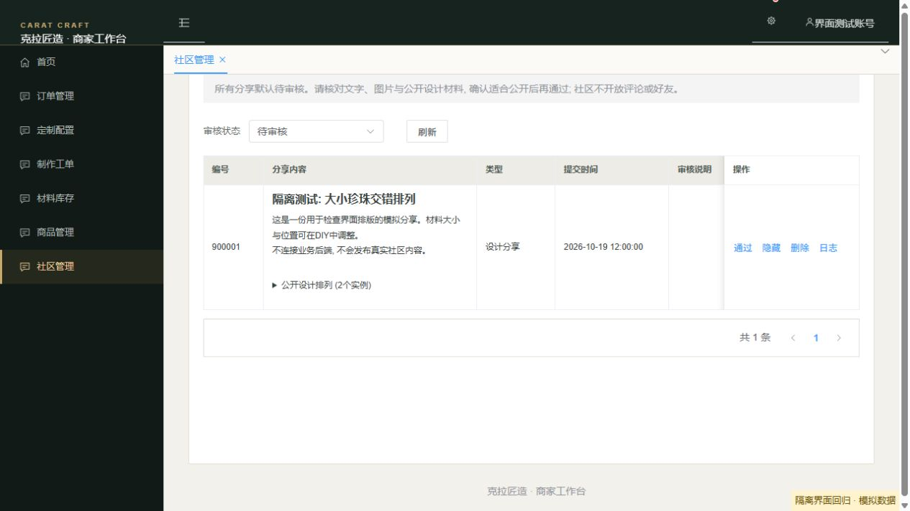
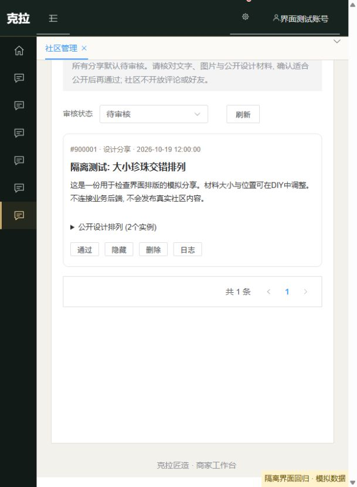

# 社区与珍珠排列编辑交付说明

本轮根据用户确认的实施计划完成社区和2D有序材料编辑, 关联甲方需求R01、R05、R06、R07、R08、R09. 此处区分源码实现、隔离验证与商户环境验收; 不将旧87项审查的完成数用作新增功能验收证据.

## 社区操作

小程序底栏进入“社区”, 可按设计、成品、建议筛选公开内容. 点击“发布分享”登录后填写标题、正文并选择图片, 最多6张, 单张最多5MB. 图片通过独立社区上传接口重新编码并记录本人归属, 不接受他人的图片ID或任意外链代替上传. 每账号每小时最多60次安全图片上传占位(含落盘或登记失败的尝试), 每天最多发布20条分享. 占位在文件落盘前提交, 未上传完成的占位不能发布或被他人冒用, 同一占位不能覆盖地址.

设计分享需先在DIY保存排列, 在发布页明确选择本人设计并同意公开材料信息. 发布页提供最近100份设计中的有效排列供选择. 服务端复制材料名称、顺序、尺寸和珍珠品质参数作为独立副本, 不公开草稿ID、材料内部ID、价格、私人刻字、身体参数、收货信息和订单信息. 社区从公开副本重建二维排列示意及材料顺序, 不依赖私人草稿接口; 超过100个实例的信息流仅显示数量, 详情仍展示完整示意, 避免长列表大量节点影响浏览. 修改或归档原草稿不会改写已发布副本. 用户自行在正文或图片中披露的信息仍会随其主动提交内容进入运营审核.

所有分享初始为待审核, 仅审核公开后进入公共列表和详情. “我的分享”显示审核进度和说明, 用户可删除自己的内容. 点赞/取消点赞提交目标状态, 数据库唯一关系保证重复或并发请求不重复计数. 社区没有评论、私信、好友或他人私人资料入口; 商城购买评价保持原有独立流程.

后台“社区管理”支持待审核、已公开、隐藏、删除状态筛选, 查看文字、图片和公开材料顺序, 审核通过、隐藏或删除均需填写原因并匹配当前版本. 每次状态变化记录操作人、前后状态及原因, 日志失败则回滚状态. 删除为终态, 不提供恢复为公开的接口. 本轮采用人工审核, 没有接入微信内容安全接口, 不将人工审核替代平台要求的商户上线审核或资质流程.

## 排列编辑操作与计价

DIY材料按商家配置分组, 首期使用珍珠`pearl`、尾扣`clasp`、配饰`accessory`或兼容的`fitting`、链条`chain`. 历史材质、款式等组继续兼容, 不迁移或删除历史订单. 点击材料库在当前选中实例后插入一项, 同一种材料可重复出现. 点击预览中的节点或序号条选择实例, 使用前移、后移、删除、复制; 复制数量可批量设置, 单次设计最多300个实例. 撤回保留最近50次排列操作, 清空经确认后也可撤回.

保存更新本人指定草稿及版本, 打开草稿恢复完整重复材料顺序. 配置或草稿详情切换时废弃迟到响应, 防止旧设计覆盖新设计. 多端保存仍受服务端版本控制. 空排列不可保存或下单, 缺必选材料、库存不足、停用选项或商家互斥/依赖规则不满足时不产生有效报价. 本轮草稿与撤回仅保证当前页面和服务端已保存内容, 不包含未保存操作跨设备同步或关闭小程序后的自动恢复.

每添加一次材料, 收取该材料配置的一次`priceDelta`, 消耗一次`stockQuantity`, 以`stockUnit`为库存单位. 示例: 单实例价格10元、耗用2颗, 添加3次则加价30元、扣6颗. 服务端按材料汇总全部实例后校验库存和累计耗用量, 不信任页面提交的价格或数量合计. 单种材料累计库存用量上限10000单位. 报价、保存、结算锁价使用同一规则; 实际扣减、取消回补和工单使用冻结BOM.

逐个实例的名称、顺序、尺寸和品质参数保留在报价`arrangement`中; 汇总材料的实例数`instances`、耗用量`quantity`、单位与行价保留在`components`中. 商品和材料后续改名、改价或停用不改写订单与工单的冻结内容. 结算显示材料汇总, 我的设计显示保存的顺序, 订单和工单可核对逐项排列. 历史`optionIds`单选模型仍可被后端读取, 继续执行原来的同组互斥校验; 新请求使用`arrangementOptionIds`, 两种模型不能同时提交.

## 商家尺寸与长度边界

后台定制配置新增珍珠直径`diameterMm`、配件占长`spanMm`、链材长度`lengthMm`及形状、光泽、瑕疵字段. 尺寸允许0.001到3000mm, 最多三位小数; 未知可留空, 不自动取规格区间中点. 珍珠品质默认近正圆、极光、微瑕, 商家应按实物覆盖, 尤其不能将异形珍珠误标为圆珠.

二维预览中珍珠使用相同缩放比例展示已配置直径; 其他材料是定位符号, 不仿造实物照片、颜色或3D效果. 缺少尺寸时明确标记未知, 不返回完整长度数值. 全部尺寸完整时, 估算长度取累计链材长度和累计非链材料占长的较大值, 避免线材穿过珠子时重复相加; 该估算不能覆盖串接延长链、扣件嵌入、伸缩、打结与工艺损耗, 不是生产承诺. 实际成品长度仍须由商家核对工艺确认. 3D颈模不在本轮范围.

采用现有微信AI建议会先确认替换排列, 可撤回, 不自动推定每种材料需要多少颗. 本轮没有变更AI服务配置, 没有请求真实模型或产生模型调用费用.

## 迁移、部署与兼容

- 新增`_sql/migrations/V20261019_01_community.sql`, 建立帖子、点赞、本人媒体和操作日志四张表, 增加社区运营菜单. 新库入口`zzzzzzz_schema_versions.sql`已同步五份V版本迁移.
- 已有库须先备份, 使用现有`tools/SchemaMigrationTool.java`查看计划并按版本顺序执行未应用迁移, 不对业务库运行完整初始化SQL. 不回改此前已应用迁移或其校验值.
- 社区查看权限为`community:post:list`, 审核权限为`community:post:moderate`, 运维需显式授予运营角色. 后台页面有独立权限判断, 服务端再次鉴权.
- 就绪探针要求最新迁移记录及社区表. 后端、后台与小程序应配套发布, 避免新排列请求发送给旧后端. 商品页和个人中心通过普通页面导航进入购物车, 不再将其作为底栏页切换.
- 未增加运行依赖或引入第三方素材. 第三方许可声明继续保留. 20261016压缩包是历史交付物, 不包含本轮社区和排列功能, 须从本轮提交重新构建.

## 验证与待验收边界

Java定向回归48项全部通过, 零失败、零跳过. 其中社区8项与订单事务5项连接真实独立MySQL库, 其余为对应服务、接口入口、就绪与安全图片处理检查. 覆盖重复材料累计价格/库存、冻结排列到工单与取消回补、历史单选设计、版本控制、社区图片归属、落盘前额度占位、公开副本隐私、幂等发布、并发点赞、下架访问阻断及日志失败回滚. 未将同一用例的模块汇总和逐类结果重复计数.

客户端30项Node回归通过, 零失败、零跳过; 包含原客户端/微信AI回归和本轮排列/社区、公开二维副本及未知尺寸用例. 管理端生产构建通过, 仍保留已有共享包体积提示. 社区后台使用固定模拟数据完成浏览器列表、公开排列、审核原因必填和日志弹窗检查, 窄屏使用卡片布局, 不写业务数据. 材料表单检查修复了数字控件自动将未知尺寸补成最小值的问题, 现在空值保持未知.

后端全部模块生产打包通过, 13个增量Java文件的Google格式、完整管理端ESLint和Git空白检查通过. 当前发布物再次核对256个运行JAR、25个前端/复制样式组件、13份对应库源码和161项已有绘图, 分发检查`errors`为空. 只同步本次重新构建的两个项目模块哈希, 没有改变任何第三方组件的许可准入或哈希.

本轮未重启、更新现有业务容器, 未对业务库应用迁移. 微信开发者工具/真机渲染、相册与真实图片存储上传、正式域名、商户运营账号以及真实支付链路仍需目标环境验收. 不将浏览器模拟后台或Node页面逻辑回归表述为小程序真机通过.

日志保存在工作区`.tools/copyright/community-*.log`. 最终独立测试库为`caratcraft_init_audit_20261019_583539`, 保留供复核; 使用13份根SQL和5份V迁移完成初始化. 早期初始化检查库`caratcraft_init_audit_20261019_1b606e`也保留, 不用于最终验收. 复跑Java可使用`python tools/run-community-regressions.py --database <独立测试库名>`, 脚本限制测试库前缀、采用已有依赖离线运行且不输出数据库密码. 界面检查使用`tools/serve-admin-ui-fixture.cjs`, 本轮仅在`127.0.0.1:18983`提供模拟数据; 按不擅自结束进程的约定暂保留该隔离预览服务, 不连接业务后端.
