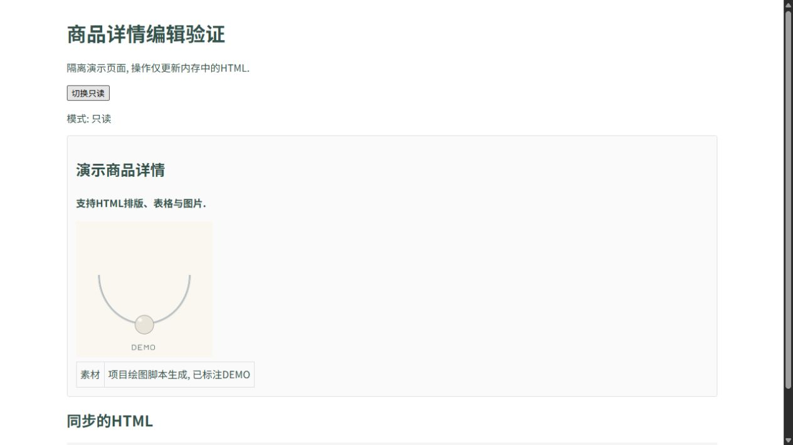

# CaratCraft版权整改结果

日期: 2026-10-14. 用户已确认实施版权整改计划. 本轮先处理应用授权、复制素材与发布材料, 其余交易、安全、界面缺陷仍按原审计清单等待后续整改.

## 已处理的内容

| 对象 | 实施结果 | 功能与证据 |
|---|---|---|
| Highcharts与UEditor附带插件 | 移除整个旧静态目录、包装组件和专用配置接口, 包括商业图表、EXE和SWF | 商品/专题/草稿5处改用项目HTML编辑组件; 原首页ECharts保留并随附许可; 图片库GET/list与POST/upload保留 |
| 编辑器替代 | 项目内实现HTML回显、源码编辑、常用排版、表格和既有图片库选择; DOMPurify3.4.17选择Apache2分支 | 浏览器验证表格回显、源码往返、脚本/事件/执行协议过滤、图片插入与只读切换; 新组件lint通过 |
| 小程序富文本 | 删除wxParse及附带旧Markdown/HTML解析库 | 两个实际消费页面使用微信原生rich-text; 不再分发旧库 |
| JDBC | MySQL Connector/J和Oracle驱动移出实际应用JAR; MariaDB Connector/J3.5.10接入所有环境配置 | 真实MySQL连接、回滚/提交、预编译分页、UTF8MB4中文/表情和新库查询通过 |
| 监控包装组件 | aizuda-monitor原POM“Apache3.0”与附加源码说明不清晰, 替换为项目HostMonitorService直接调用OSHI6.8.2 | 保留原接口和权限/JSON契约; 3个真实采集定向测试通过, 不打印机器秘密 |
| 旧依赖链 | Velocity Tools改为实际使用的Velocity引擎; 移除其未用Struts等依赖链及旧Servlet2.5 | 后台/API重新打包通过, 当前运行组件索引不含已移除依赖 |
| 图片与图标 | 161个资源重新从项目绘图脚本生成, 包括商品示意、配件层、图标、logo及3处favicon | 保持路径/画布尺寸; 珠宝成品示意标注DEMO; [来源与SHA256](../vendor/platform-wxshop/legal/project-assets.json) |
| 库字体 | ElementUI主题字体与官方已安装2.15.10文件相符 | 保留MIT声明, 不冒称字体为项目自有 |
| 种子数据 | mall.sql保留37张表结构, 清理第三方商品图、广告文案和演示用户; 使用项目最小桥接与现有珠宝演示迁移 | 独立新库12份初始化脚本通过; 3商品、1项目广告、0演示用户、2定制配置, 外链商品图为0; 原业务库未修改 |
| 旧品牌与文档 | 重写底座README; 移除3份旧DOCX、旧Qoder文档、助手配置和空分包; 移除统计账号与无关回调默认域名、短信签名 | 版权条款中的原声明保留, 不批量重署名 |
| 发布许可材料 | 核对256个不同后端运行组件和36个前端/复制样式组件, 追溯父POM/JAR声明及确切版本源码 | [许可索引](../vendor/platform-wxshop/legal/generated/runtime-components.json), 13份Java对应源码、7份MIT原始发布包及原声明随交付保留 |

本轮未把“缺少单独LICENSE文件”直接判为侵权. 对明确MIT声明的旧npm包, 使用官方同版本元数据与原始发布包完整性校验保留证据和所有源声明. 对dom4j、COS、阿里云SDK, 核对其确切版本官方源码中的授权头并原样保留. 许可证名称错误的监控包装库则移除, 避免依赖不明确的许可表述.

## 验证结果与边界

- 后台和API: 版权替换后的Maven package成功. 新监控3用例, 0失败/错误/跳过.
- 前端: 隔离生产webpack构建成功, 原审计的5个无关lint错误仍以2条模块warning存在; 未把它们视作本轮已修复.
- 编辑器: 浏览器使用当前源组件验证, 图片库通过隔离适配器选择演示图; 未上传真实文件或保存真实商品. 商品/专题HTML使用格式保留, 旧Flash、截图插件与UEditor专用图表功能不再提供.
- JDBC: 真实数据库验证在连接级临时表进行, 关闭连接即消失. 后续Docker接口不可用, 没有自行重启; 外部库优先加载机制使用实际API JAR离线验证通过.
- 依赖链收敛: 使用实际API发布JAR的类, 验证Velocity模板渲染与dom4j中文XML解析均通过, 不调用外部服务.
- 新库: `caratcraft_copyright_audit_20261014`保留为审查数据集, 没有清理, 用户可自行决定后续保留/删除.
- 本轮没有启动新的业务实例、重建现有容器、提交或推送Git, 也没有重新运行真实微信支付/退款/短信.

## 商用交付方式

应用交付需包含[legal目录](../vendor/platform-wxshop/legal/README.md), 保留原版权声明、对应源码及已选择的许可义务. 业务代码没有通过修改作者名字来确权. 对未来新增的商家摄影、商标、文案、字体与数据, 同样要记录来源.

MySQL服务端、Redis、JRE、Nginx和基础操作系统镜像不包含在本轮应用交付包内, 部署者从官方渠道取得. 完整镜像或整机/OEM再分发应针对确切摘要另外核验全部基础软件的声明和源码义务; 本轮没有批准这种交付.

旧Git历史仍包含已移除资源, 不重写历史. 商业源码交付应使用工具导出的当前源码包, 不包含`.git`, 不直接把整个旧历史作为本次已核验的商业交付物. `tools/package-commercial-application.py`只导出当前树、应用和许可材料, 不含私有配置或历史审计截图.

原来的[全仓审计](audit-2026-10-13.md)及其文件哈希是整改前记录, 不是当前版权状态. 本轮实际发布物以[版权准入检查](../vendor/platform-wxshop/legal/distribution-check.json)为准. 本材料不保证排除所有未知权利主张, 也不承诺任何AI检测或平台审核结果.

建议提交说明: chore：替换授权不明确组件与旧商城素材并补齐商用分发许可及源码材料
